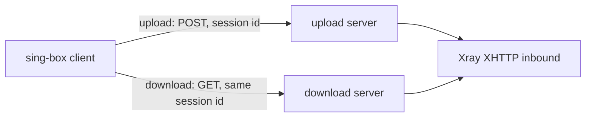

# sing-box-ut

**English** · [简体中文](README.zh-CN.md)

Patches that give sing-box a native VLESS + XHTTP client with split upload/download, so clients can drop xray-core.

[](https://github.com/10ta/sing-box-ut/actions/workflows/verify-download.yml)

```text
$ test/interop/run.sh ./sing-box xray-bin/xray
== stream-up / plain
ok: payload intact, 1 connection(s) via the download server
== packet-up / plain
ok: payload intact, 1 connection(s) via the download server
== stream-up / full
ok: payload intact, 1 connection(s) via the download server
== packet-up / full
ok: payload intact, 1 connection(s) via the download server
PASS
```
*A patched sing-box client against a real Xray 26.11.9 server, upload and download on different addresses.*

## Contents

- [Why sing-box-ut?](#-why-sing-box-ut)
- [Quick Start](#-quick-start)
- [Usage](#-usage)
- [Configuration](#-configuration)
- [Update & Maintenance](#-update--maintenance)
- [How It Works](#-how-it-works)
- [Project Structure](#-project-structure)
- [Development](#-development)
- [Limitations & Roadmap](#-limitations--roadmap)
- [Upstream & Differences](#-upstream--differences)
- [Documentation](#-documentation)
- [License](#-license)

## 💡 Why sing-box-ut?

Xray's XHTTP can send uploads to one server and downloads to another (`downloadSettings`). No sing-box build could, so a sing-box client that needs it has to run xray-core next to it. This repository carries the missing piece as a patch on top of [sing-box-lx](https://github.com/Leadaxe/sing-box-lx), which already has an XHTTP client and VLESS encryption.

- ✅ Good fit: a sing-box client that talks to an Xray server over VLESS + XHTTP with `downloadSettings`.
- ❌ Not a fit: you need a ready-made binary (none is published yet, see [Limitations & Roadmap](#-limitations--roadmap)), an XHTTP server (client only, keep Xray on the server), or `stream-one` mode with a split download.

## 🚀 Quick Start

Needs git and Go 1.26 or newer on Linux.

```bash
git clone https://github.com/10ta/sing-box-ut
cd sing-box-ut
git clone --depth 1 -b lx-1.15 --recurse-submodules --shallow-submodules https://github.com/Leadaxe/sing-box-lx lx
git -C lx apply ../patches/0002-lx-xhttp-download.patch
cd lx
env CGO_ENABLED=0 go build -trimpath -tags "with_quic,with_utls,with_clash_api,with_xhttp,badlinkname,tfogo_checklinkname0" -ldflags "-s -w -checklinkname=0" -o ../sing-box ./cmd/sing-box
cd ..
./sing-box version
```

The last command prints the build tags, which must include `with_xhttp`:

```text
sing-box version unknown

Environment: go1.26.6 linux/amd64
Tags: with_quic,with_utls,with_clash_api,with_xhttp,badlinkname,tfogo_checklinkname0
```

## 🧭 Usage

### Verify the client against a real Xray server

Needs bash, python3, curl and unzip, with ports 1080, 6501, 6502 and 8000 free on 127.0.0.1.

```bash
curl -fsSL -o xray.zip https://github.com/XTLS/Xray-core/releases/download/v26.11.9/Xray-linux-64.zip
unzip -q xray.zip xray -d xray-bin
test/interop/run.sh ./sing-box xray-bin/xray
```

It ends with `PASS`, as in the output at the top. Each case fetches a 5 MB file through the proxy and checks that the download request went through the second address. The `full` cases use TLS 1.3, HTTP/2, uTLS, VLESS encryption, X-Padding obfuscation and XMUX together.

### Run the same checks in GitHub Actions

Open **Actions → verify-download → Run workflow**. It also runs on every push that touches the patch, the interop test or the workflow. The job applies the patch to sing-box-lx, runs `gofmt`, `go vet` and the unit tests, builds the client and runs the interop test.

## 🔧 Configuration

The patch adds one object, `download`, to the XHTTP transport of a VLESS outbound. Everything else is sing-box-lx's XHTTP configuration.

| Name | Required | Default | Description |
|---|---|---|---|
| `download.server` | ✅ | — | Address of the download server |
| `download.server_port` | ✅ | — | Port of the download server |
| `download.tls` | ❌ | cleartext | Outbound TLS options for the download server |
| `download.path`, `host`, `headers`, `x_padding_*`, `xmux`, … | ❌ | transport defaults | The XHTTP options of the download request. Nothing is inherited from the upload side |
| `download.mode` | ❌ | upload side's mode | Leave empty. A different value is rejected |

Rules, matching Xray:

- The download request shares the session id with the upload and uses the outbound's own dialer (detour, bind).
- `stream-one` with `download` is rejected. `auto` with `download` becomes `packet-up`, or `stream-up` under REALITY.
- `download` cannot contain another `download`.

Minimal example (the shape of the `full` case in [`test/interop/gen.py`](test/interop/gen.py)):

```json
{
  "type": "vless",
  "server": "up.example.com",
  "server_port": 443,
  "uuid": "<YOUR_UUID>",
  "encryption": "<YOUR_VLESS_ENCRYPTION>",
  "tls": { "enabled": true, "server_name": "up.example.com", "alpn": ["h2", "http/1.1"] },
  "transport": {
    "type": "xhttp",
    "mode": "stream-up",
    "path": "/<YOUR_PATH>/",
    "x_padding_bytes": "92-1254",
    "download": {
      "server": "down.example.com",
      "server_port": 443,
      "tls": { "enabled": true, "server_name": "down.example.com", "alpn": ["h2", "http/1.1"] },
      "path": "/<YOUR_PATH>/",
      "x_padding_bytes": "92-1254"
    }
  }
}
```

| Xray `downloadSettings` | Here |
|---|---|
| `address`, `port` | `download.server`, `download.server_port` |
| `security`, `tlsSettings` | `download.tls` |
| `xhttpSettings.*` | `download.*` in snake_case, for example `xPaddingBytes` → `x_padding_bytes` |

## 🔄 Update & Maintenance

### When sing-box-lx changes

The workflow follows the tip of `lx-1.15`. If lx touches the lines the patch changes, the "Apply the download patch" step fails. Rebuild the patch in a fresh lx clone:

```bash
git -C lx apply --reject ../patches/0002-lx-xhttp-download.patch
# fix every *.rej by hand, delete them, then:
git -C lx add -A
git -C lx diff --cached > patches/0002-lx-xhttp-download.patch
```

### When Xray releases a new version

The interop test pins Xray (`XRAY_VERSION` in the workflow) because server defaults change between releases. To move the pin, run the workflow with the new tag in the `xray_version` input, and change the default once it passes.

## 🧠 How It Works



- **The download endpoint is a second XHTTP client** → it reuses every request-shaping rule (padding, placement, headers, HTTP version) and gets its own connection pool, with about 70 changed lines in existing sing-box-lx files.
- **Both pooled connections are released together** → a closed or failed connection can never leak a slot in either pool.
- **A patch, not a fork** → sing-box-lx keeps moving. A patch on four of its files is cheap to carry and fails loudly when it stops applying.

## 📁 Project Structure

```text
.
├── patches/
│   └── 0002-lx-xhttp-download.patch   # the change: XHTTP download endpoint + unit tests
├── test/interop/
│   ├── run.sh                         # runs every case against a real Xray
│   ├── gen.py                         # writes the Xray and sing-box configs for one case
│   └── tcp_tap.py                     # stands in for the download server, logs what reaches it
├── .github/workflows/
│   └── verify-download.yml            # apply, vet, test, build, interop
├── docs/NOTES.zh-CN.md                # research, decisions and pitfalls (Chinese)
└── AGENTS.md                          # commands and conventions for AI coding agents
```

Files the patch changes in sing-box-lx:

| File | Change |
|---|---|
| `option/v2ray_xhttp.go` | Adds the `download` field |
| `option/v2ray_xhttp_download_ut.go` | New: the `download` option type |
| `transport/v2rayxhttp/client.go` | Builds the download endpoint, resolves the mode |
| `transport/v2rayxhttp/conn.go` | Sends the download GET through the download endpoint |
| `transport/v2rayxhttp/xmux.go` | Releases the download connection with the upload one |
| `transport/v2rayxhttp/download_ut.go` | New: download endpoint logic |
| `transport/v2rayxhttp/download_ut_test.go` | New: unit tests |

## 🔨 Development

Run inside the patched `lx` directory from [Quick Start](#-quick-start):

```bash
gofmt -l option/v2ray_xhttp*.go transport/v2rayxhttp/
go vet -tags "with_quic,with_utls,with_clash_api,with_xhttp,badlinkname,tfogo_checklinkname0" ./option/ ./transport/v2rayxhttp/
go test -count=1 -race -tags "with_quic,with_utls,with_clash_api,with_xhttp,badlinkname,tfogo_checklinkname0" ./option/ ./transport/v2rayxhttp/
```

`gofmt` prints nothing and both test packages report `ok`. Lines the patch adds to lx files are marked `// ut:`. Keep new code in the `*_ut.go` files so the patch touches as few lx lines as possible.

## 🚧 Limitations & Roadmap

- No binaries are published. The automated build that produces a Linux `.deb` and an Android APK from the latest sing-box alpha is designed in [docs/NOTES.zh-CN.md](docs/NOTES.zh-CN.md) but is not in this repository yet.
- Tested on Linux amd64 only. Not tested: a download endpoint over HTTP/3 or REALITY, dialing through a detour, Android.
- Client only. sing-box-lx has no XHTTP server.

## 🔀 Upstream & Differences

Based on [Leadaxe/sing-box-lx](https://github.com/Leadaxe/sing-box-lx) branch `lx-1.15` at `20723b7`, which merges [SagerNet/sing-box](https://github.com/SagerNet/sing-box) `v1.15.0-alpha.13`.

| Aspect | sing-box | sing-box-lx | This repository |
|---|---|---|---|
| XHTTP client | ❌ | ✅ | ✅ |
| VLESS encryption | ❌ | ✅ | ✅ |
| Download through another server | ❌ | ❌ | ✅ |

Sync is manual: the workflow reports when the patch stops applying, see [Update & Maintenance](#-update--maintenance).

## 📚 Documentation

- [AGENTS.md](AGENTS.md): commands, conventions and pitfalls for AI coding agents.
- [docs/NOTES.zh-CN.md](docs/NOTES.zh-CN.md): research on the candidate implementations, design decisions, test record and pitfalls (Chinese).

## 📄 License

<!-- TODO: add a LICENSE file. -->
No license file yet. The patch modifies sing-box and sing-box-lx source code, which is licensed under GPL-3.0-or-later.
