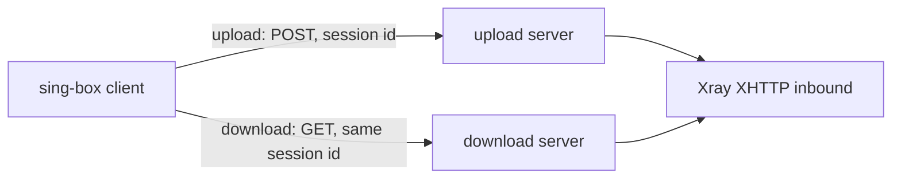

# sing-box-ut

**English** · [简体中文](README.zh-CN.md)

Patches that give sing-box a native VLESS + XHTTP client with split upload/download, so clients can drop xray-core.

[](https://github.com/10ta/sing-box-ut/actions/workflows/build.yml)

What works today, each item tested against a real Xray server:

- Upload and download through two different servers (Xray `downloadSettings`), each with its own address, TLS and XHTTP options.
- `stream-up` and `packet-up` modes, over HTTP/2, HTTP/3 (QUIC) and HTTP/1.1.
- VLESS encryption (`mlkem768x25519plus`), X-Padding obfuscation, XMUX, uTLS fingerprints.

## Contents

- [Why sing-box-ut?](#-why-sing-box-ut)
- [Quick Start](#-quick-start)
- [Installation](#-installation)
- [Usage](#-usage)
- [Configuration](#-configuration)
- [Update & Maintenance](#-update--maintenance)
- [How It Works](#-how-it-works)
- [Project Structure](#-project-structure)
- [Development](#-development)
- [Limitations & Roadmap](#-limitations--roadmap)
- [Upstream & Differences](#-upstream--differences)
- [Documentation](#-documentation)
- [License](#-license)

## 💡 Why sing-box-ut?

Xray's XHTTP can send uploads to one server and downloads to another (`downloadSettings`). No sing-box build could, so a sing-box client that needs it has to run xray-core next to it. This repository builds the latest sing-box alpha with the XHTTP client and VLESS encryption of [sing-box-lx](https://github.com/Leadaxe/sing-box-lx), plus the missing split download.

- ✅ Good fit: a sing-box client that talks to an Xray server over VLESS + XHTTP, with or without `downloadSettings`.
- ❌ Not a fit: you need the Vision flow (`xtls-rprx-vision` is not supported for now), an XHTTP server (client only, keep Xray on the server), or `stream-one` mode with a split download.

## 🚀 Quick Start

Build from source on Linux. Needs git, bash and the Go version upstream builds with (1.26.10 for `v1.15.0-alpha.13`).

```bash
git clone https://github.com/10ta/sing-box-ut
cd sing-box-ut
scripts/prepare.sh work
scripts/build.sh work sing-box
./sing-box version
```

`prepare.sh` assembles the source in `work/` from the newest sing-box tag. The last command prints the version, which ends in `-ut`:

```text
sing-box version 1.15.0-alpha.13-ut
```

## 📦 Installation

Prebuilt files are attached to each [release](https://github.com/10ta/sing-box-ut/releases), one prerelease per sing-box tag, named `<tag>-ut`.

| File | For |
|---|---|
| `sing-box_<version>_linux_amd64.deb`, `…_arm64.deb` | Debian and Ubuntu. Same package name and layout as the official `sing-box` package, which it replaces |
| `sing-box_<version>_windows_amd64.zip`, `…_arm64.zip` | Windows: `sing-box.exe` |
| `SFA-<version>-arm64-v8a.apk` | Android (sing-box for Android with the patched core) |

The Android app keeps the official application id, so it cannot be installed next to the official SFA, and switching between the two needs an uninstall first. An APK whose name ends in `-UNSIGNED-KEY` was signed with a throwaway key and cannot be updated in place.

## 🧭 Usage

### Verify a build against a real Xray server

Needs bash, python3, curl and unzip, with ports 1080, 6501, 6502 and 8000 free on 127.0.0.1.

```bash
curl -fsSL -o xray.zip https://github.com/XTLS/Xray-core/releases/download/v26.11.9/Xray-linux-64.zip
unzip -q xray.zip xray -d xray-bin
test/interop/run.sh ./sing-box xray-bin/xray
```

Each case fetches a 5 MB file through the proxy and checks that the download request went through the second address. `plain` is cleartext HTTP/1.1. `full` uses TLS 1.3, HTTP/2, uTLS, VLESS encryption, X-Padding obfuscation and XMUX together. `h3` is `full` over HTTP/3. Expected output:

```text
== stream-up / plain
ok: payload intact, 1 connection(s) via the download server
== packet-up / plain
ok: payload intact, 1 connection(s) via the download server
== stream-up / full
ok: payload intact, 1 connection(s) via the download server
== packet-up / full
ok: payload intact, 1 connection(s) via the download server
== stream-up / h3
ok: payload intact, 1 connection(s) via the download server
== packet-up / h3
ok: payload intact, 1 connection(s) via the download server
PASS
```

### Build for another platform, or pack a .deb

```bash
env GOOS=windows GOARCH=arm64 scripts/build.sh work sing-box.exe
scripts/package-deb.sh work sing-box amd64 1.15.0-alpha.13 sing-box_amd64.deb
```

## 🔧 Configuration

The only addition to sing-box-lx's XHTTP configuration is one object, `download`, in the XHTTP transport of a VLESS outbound.

| Name | Required | Default | Description |
|---|---|---|---|
| `download.server` | ✅ | — | Address of the download server |
| `download.server_port` | ✅ | — | Port of the download server |
| `download.tls` | ❌ | cleartext | Outbound TLS options for the download server |
| `download.path`, `host`, `headers`, `x_padding_*`, `xmux`, … | ❌ | transport defaults | The XHTTP options of the download request. Nothing is inherited from the upload side |
| `download.mode` | ❌ | upload side's mode | Leave empty. A different value is rejected |

Rules, matching Xray:

- The download request shares the session id with the upload and uses the outbound's own dialer (detour, bind).
- `stream-one` with `download` is rejected. `auto` with `download` becomes `packet-up`, or `stream-up` under REALITY.
- `download` cannot contain another `download`.

### Complete example

A VLESS outbound that uploads through `up.example.com` and downloads through `down.example.com`. It is the sing-box-ut form of a real Xray client config. Replace every `<…>` placeholder.

```json
{
  "type": "vless",
  "tag": "xhttp-split",
  "server": "up.example.com",
  "server_port": 443,
  "uuid": "<UUID>",
  "encryption": "<VLESS_ENCRYPTION>",
  "tls": {
    "enabled": true,
    "server_name": "up.example.com",
    "alpn": ["h2", "http/1.1"],
    "min_version": "1.3",
    "utls": { "enabled": true, "fingerprint": "ios" }
  },
  "transport": {
    "type": "xhttp",
    "mode": "stream-up",
    "path": "/<SECRET_PATH>/",
    "x_padding_bytes": "92-1254",
    "x_padding_obfs_mode": true,
    "x_padding_method": "tokenish",
    "x_padding_placement": "queryInHeader",
    "x_padding_key": "<PADDING_KEY>",
    "x_padding_header": "X-Cache",
    "xmux": {
      "max_concurrency": "8-16",
      "c_max_reuse_times": 0,
      "h_max_request_times": "600-900",
      "h_max_reusable_secs": "1800-3000",
      "h_keep_alive_period": 30
    },
    "download": {
      "server": "down.example.com",
      "server_port": 443,
      "tls": {
        "enabled": true,
        "server_name": "down.example.com",
        "alpn": ["h2", "http/1.1"],
        "min_version": "1.3",
        "utls": { "enabled": true, "fingerprint": "ios" }
      },
      "path": "/<SECRET_PATH>/",
      "x_padding_bytes": "92-1254",
      "x_padding_obfs_mode": true,
      "x_padding_method": "tokenish",
      "x_padding_placement": "queryInHeader",
      "x_padding_key": "<PADDING_KEY>",
      "x_padding_header": "X-Cache",
      "xmux": {
        "max_concurrency": "8-16",
        "c_max_reuse_times": 0,
        "h_max_request_times": "600-900",
        "h_max_reusable_secs": "1800-3000",
        "h_keep_alive_period": 30
      }
    }
  }
}
```

The matching server side is in [`examples/`](examples/): [`xray-server.json`](examples/xray-server.json) (one Xray inbound) and [`Caddyfile`](examples/Caddyfile) (TLS termination in front of it, on both servers). The client and server examples pass `sing-box check` and `xray run -test`; the Caddyfile has not been run by the author of this document.

### HTTP/3

Set `alpn` to `["h3"]` in `tls` and in `download.tls`. The two halves are independent, so one may stay on HTTP/2. A `utls` fingerprint is ignored over QUIC, with a warning in the log. The server must be reachable on UDP: Caddy serves HTTP/3 on the UDP port with the same number as its HTTPS port and still forwards h2c to Xray, so the Caddyfile does not change.

### Xray settings without a counterpart

| Xray client setting | Here |
|---|---|
| `flow: xtls-rprx-vision` | Not supported for now. Use it on neither side |
| `finalmask.quicParams` (congestion control, receive windows) | Not configurable. It applies to HTTP/3 only; here QUIC runs with quic-go defaults |
| `finalmask.udp` (noise) | Not supported |
| `testpre` | Not supported |
| `flow`, `encryption`, `testpre` inside `downloadSettings` | Not transport settings. Drop them |

## 🔄 Update & Maintenance

### A new sing-box tag

The `build` workflow runs daily, and builds and publishes when upstream has a tag without a release here. Nothing to do unless it fails. A failure usually means upstream changed one of the five files `patches/0001-upstream-seams.patch` touches: fix the patch against the new tag and push.

### A newer sing-box-lx

The build copies files from the one sing-box-lx commit pinned in `lx.ref`, because lx's XHTTP code keeps gaining dependencies on lx-only packages. To move the pin, try the new commit or branch first:

```bash
env LX_REF=lx-1.15 scripts/prepare.sh work-next
```

If the tree builds and `test/interop/run.sh` passes, write the commit's full SHA into `lx.ref`. If a copied file now imports a package upstream does not have, add that package to `lx-files.txt` or stay on the old pin.

### A new Xray version

The interop test pins Xray (`XRAY_VERSION` in the workflow) because server defaults change between releases. Change the pin and push; the workflow shows whether the test still passes.

### Secrets

| Secret | Required | Purpose |
|---|---|---|
| `ANDROID_KEYSTORE_BASE64` | ❌ | Base64 of the keystore that signs the APK. Without it each run uses a throwaway key |
| `ANDROID_KEYSTORE_PASS`, `ANDROID_KEY_ALIAS`, `ANDROID_KEY_PASS` | ❌ | Keystore password, key alias, key password (defaults to the keystore password) |
| `TG_BOT_TOKEN`, `TG_CHAT_ID` | ❌ | Telegram message when a build fails |

GitHub disables scheduled workflows after 60 days without repository activity; re-enable it on the Actions page.

## 🧠 How It Works



- **Upstream source, not a fork** → every build starts from the untouched sing-box tag, so there is no merge to maintain. Files are copied in from sing-box-lx, and two small patches connect them.
- **The download endpoint is a second XHTTP client** → it reuses every request-shaping rule (padding, placement, headers, HTTP version) and gets its own connection pool.
- **Both pooled connections are released together** → a closed or failed connection can never leak a slot in either pool.

## 📁 Project Structure

```text
.
├── lx.ref                    # the sing-box-lx commit the build copies files from
├── lx-files.txt              # which sing-box-lx files are copied
├── patches/
│   ├── 0001-upstream-seams.patch      # hooks XHTTP and VLESS encryption into upstream files
│   └── 0002-lx-xhttp-download.patch   # the download endpoint, on the copied lx files
├── overlay/                  # our own files, copied over the tree (libbox build tag)
├── scripts/
│   ├── prepare.sh            # assembles the source tree
│   ├── build.sh              # compiles sing-box from it
│   ├── package-deb.sh        # packs a .deb
│   └── go-version.sh         # the Go version upstream builds with
├── test/interop/             # runs the client against a real Xray server
├── examples/                 # complete configs: sing-box client, Xray server, Caddyfile
├── .github/workflows/build.yml
├── docs/NOTES.zh-CN.md       # research, decisions and pitfalls (Chinese)
└── AGENTS.md                 # commands and conventions for AI coding agents
```

## 🔨 Development

Run the unit tests of the patched packages in a prepared tree:

```bash
cd work
go vet -tags "with_quic,with_utls,with_xhttp,badlinkname,tfogo_checklinkname0" ./option/ ./transport/v2rayxhttp/ ./protocol/vless/...
go test -count=1 -tags "with_quic,with_utls,with_xhttp,badlinkname,tfogo_checklinkname0" ./option/ ./transport/v2rayxhttp/
```

Both test packages report `ok`. To change the download logic, edit the files in `work/`, then regenerate `patches/0002-lx-xhttp-download.patch` as described in [AGENTS.md](AGENTS.md). Lines added to lx files are marked `// ut:`; new code goes in `*_ut.go` files.

## 🚧 Limitations & Roadmap

- No Vision flow for now, and no control over QUIC congestion or windows, see [Configuration](#-configuration).
- The Linux and Windows builds use upstream's default tags without the naive outbound.
- Tested on Linux amd64 against Xray terminating TLS itself. Not tested: Caddy in front of Xray, a CDN, REALITY on the download endpoint, dialing through a detour. The Windows and Android builds have not been run by the author of this document.
- Client only. sing-box-lx has no XHTTP server.

## 🔀 Upstream & Differences

Built from [SagerNet/sing-box](https://github.com/SagerNet/sing-box) at its newest tag (verified with `v1.15.0-alpha.13`), with files from [Leadaxe/sing-box-lx](https://github.com/Leadaxe/sing-box-lx) at the commit in `lx.ref`.

| Aspect | sing-box | sing-box-lx | This repository |
|---|---|---|---|
| XHTTP client | ❌ | ✅ | ✅ |
| VLESS encryption | ❌ | ✅ | ✅ |
| Download through another server | ❌ | ❌ | ✅ |
| Everything else in sing-box-lx | ❌ | ✅ | ❌ |

Sync with upstream is automatic, see [Update & Maintenance](#-update--maintenance).

## 📚 Documentation

- [AGENTS.md](AGENTS.md): commands, conventions and pitfalls for AI coding agents.
- [docs/NOTES.zh-CN.md](docs/NOTES.zh-CN.md): research on the candidate implementations, design decisions, test record and pitfalls (Chinese).

## 📄 License

[GPL-3.0-or-later](LICENSE). The patches modify sing-box and sing-box-lx source code, which carry the same license.
