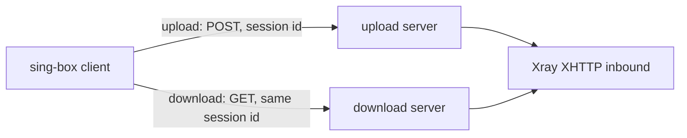

# sing-box-ut

**English** · [简体中文](README.zh-CN.md)

Patches that give sing-box Xray's XHTTP client (split upload/download) and WARP over MASQUE, so clients can drop xray-core.

[](https://github.com/10ta/sing-box-ut/actions/workflows/build.yml)

What works today, each XHTTP item tested against a real Xray server:

- Upload and download through two different servers (Xray `downloadSettings`), each with its own address, TLS and XHTTP options.
- `stream-up` and `packet-up` modes, over HTTP/2, HTTP/3 (QUIC) and HTTP/1.1.
- VLESS encryption (`mlkem768x25519plus`), X-Padding obfuscation, XMUX, uTLS fingerprints.
- BBR or Brutal congestion control over HTTP/3 (`force-brutal` in Xray's `finalmask.quicParams`).
- Cloudflare WARP and Zero Trust over MASQUE (HTTP/3) in the `masque-client` endpoint, Brutal or BBR included. Tested against a local stand-in for Cloudflare's edge, not yet against Cloudflare itself.

## Contents

- [Why sing-box-ut?](#-why-sing-box-ut)
- [Quick Start](#-quick-start)
- [Installation](#-installation)
- [Usage](#-usage)
- [Configuration](#-configuration)
- [Update & Maintenance](#-update--maintenance)
- [How It Works](#-how-it-works)
- [Project Structure](#-project-structure)
- [Development](#-development)
- [Limitations & Roadmap](#-limitations--roadmap)
- [Upstream & Differences](#-upstream--differences)
- [Documentation](#-documentation)
- [License](#-license)

## 💡 Why sing-box-ut?

Xray's XHTTP can send uploads to one server and downloads to another (`downloadSettings`). No sing-box build could, so a sing-box client that needs it has to run xray-core next to it. This repository builds the latest sing-box alpha with the XHTTP client and VLESS encryption of [sing-box-lx](https://github.com/Leadaxe/sing-box-lx), plus the missing split download.

The same goes for Cloudflare WARP over MASQUE: Xray reaches it with `masqueSettings.warp`, but upstream's `masque-client` speaks only standard CONNECT-IP, which Cloudflare's edge does not accept. This repository adds a `warp` mode to it.

- ✅ Good fit: a sing-box client that talks to an Xray server over VLESS + XHTTP, with or without `downloadSettings`; or one that uses WARP or Zero Trust over MASQUE instead of running Xray or usque.
- ❌ Not a fit: you need the Vision flow (`xtls-rprx-vision` is not supported for now), an XHTTP server (client only, keep Xray on the server), `stream-one` mode with a split download, or WARP over HTTP/2 (TCP), which is not done yet.

## 🚀 Quick Start

Build from source on Linux. Needs git, bash, python3 and the Go version upstream builds with (1.26.10 for `v1.15.0-alpha.13`).

```bash
git clone https://github.com/10ta/sing-box-ut
cd sing-box-ut
scripts/prepare.sh work
scripts/build.sh work sing-box
./sing-box version
```

`prepare.sh` assembles the source in `work/` from the sing-box tag in `upstream.ref` and the sing-box-lx commit in `lx.ref`. The last command prints the version, which ends in `-ut`:

```text
sing-box version 1.15.0-alpha.13-ut
```

## 📦 Installation

Prebuilt files are attached to each [release](https://github.com/10ta/sing-box-ut/releases), one prerelease per build: `<tag>-ut`, then `<tag>-ut.2`, `<tag>-ut.3`, … for later builds of the same sing-box tag. Package managers order them correctly, so the newest one always wins an upgrade. Every file is named `sing-box_<version>_<os>_<arch>.<ext>`.

| File | For |
|---|---|
| `sing-box_<version>_linux_amd64.deb`, `…_arm64.deb` | Debian and Ubuntu. Same package name and layout as the official `sing-box` package, which it replaces. Includes `/usr/lib/libcronet.so` for the naive outbound |
| `sing-box_<version>_linux_amd64.tar.gz`, `…_arm64.tar.gz` | Any Linux with glibc: `sing-box` and `libcronet.so` in one directory, no installation |
| `sing-box_<version>_windows_amd64.zip`, `…_arm64.zip` | Windows: one folder with `sing-box.exe` and `libcronet.dll` for the naive outbound (keep them together) |
| `sing-box_<version>_android_arm64.apk` | Android: sing-box for Android (SFA) with the patched core, for arm64-v8a devices |

The Android app keeps the official application id, so it cannot be installed next to the official SFA, and switching between the two needs an uninstall first. An APK whose name ends in `_throwaway-key` was signed with a one-off key and cannot be updated in place.

## 🧭 Usage

### Verify a build against a real Xray server

Needs bash, python3, curl and unzip, with ports 1080, 6501, 6502 and 8000 free on 127.0.0.1.

```bash
curl -fsSL -o xray.zip https://github.com/XTLS/Xray-core/releases/download/v26.11.9/Xray-linux-64.zip
unzip -q xray.zip xray -d xray-bin
test/interop/run.sh ./sing-box xray-bin/xray
```

Each case fetches a 5 MB file through the proxy and checks that the download request went through the second address. `plain` is cleartext HTTP/1.1. `full` uses TLS 1.3, HTTP/2, uTLS, VLESS encryption, X-Padding obfuscation and XMUX together. `h3` is `full` over HTTP/3. `brutal` is `h3` plus `quic_params` (Brutal on the upload half, BBR on the download half) and checks the client log shows Brutal running. Expected output:

```text
== stream-up / plain
ok: payload intact, 1 connection(s) via the download server
== packet-up / plain
ok: payload intact, 1 connection(s) via the download server
== stream-up / full
ok: payload intact, 1 connection(s) via the download server
== packet-up / full
ok: payload intact, 1 connection(s) via the download server
== stream-up / h3
ok: payload intact, 1 connection(s) via the download server
== packet-up / h3
ok: payload intact, 1 connection(s) via the download server
== stream-up / brutal
ok: payload intact, 1 connection(s) via the download server
PASS
```

### Build for another platform, or pack a .deb

```bash
env GOOS=windows GOARCH=arm64 scripts/build.sh work sing-box.exe
scripts/package-deb.sh work sing-box amd64 1.15.0-alpha.13-ut sing-box_amd64.deb
```

## 🔧 Configuration

On top of sing-box-lx's XHTTP options there are two objects in the XHTTP transport: `download` (split upload and download) and `quic_params` (HTTP/3 congestion control). The `masque-client` endpoint gets `warp` (Cloudflare WARP, [below](#cloudflare-warp-over-masque)) and the same `quic_params`. Defaults and behaviour of every field are in the comments of the [complete example](#complete-example). sing-box accepts `//` comments, so the examples work as they are. Replace every `<…>` placeholder with your own value.

### Minimal example

The fewest fields that connect to the server in [`examples/xray-server.json`](examples/xray-server.json):

```jsonc
{
  "type": "vless",
  "tag": "xhttp",
  "server": "up.example.com",
  "server_port": 443,
  "uuid": "<UUID>",
  "encryption": "<VLESS_ENCRYPTION>", // omit when the server's decryption is "none"
  "tls": {
    "enabled": true,
    "server_name": "up.example.com"   // no alpn: HTTP/2
  },
  "transport": {
    "type": "xhttp",                  // no mode: auto = packet-up
    "path": "/<SECRET_PATH>/",
    // match the server's xPadding* (placement queryInHeader is the default)
    "x_padding_obfs_mode": true,
    "x_padding_key": "<PADDING_KEY>",
    "x_padding_header": "X-Cache",
    "x_padding_method": "tokenish"
  }
}
```

### Complete example

Every field that takes effect is written out with its default; fields that only take effect in another mode or combination are listed as comments. Here the upload goes over HTTP/3 through a CDN with Brutal, the download over HTTP/2 straight to a second server. As a file: [`examples/sing-box-client.jsonc`](examples/sing-box-client.jsonc).

```jsonc
{
  "type": "vless",
  "tag": "xhttp-split",
  "server": "up.example.com",
  "server_port": 443,
  "uuid": "<UUID>",
  // = the server's "decryption"; omit when that is "none"
  "encryption": "<VLESS_ENCRYPTION>",
  // "flow": not supported (no Vision)
  // default "xudp"; also "packetaddr", or "" for none
  "packet_encoding": "xudp",
  // dial fields (detour, bind_interface, ...) work as usual and serve both halves
  "tls": {
    "enabled": true,
    "server_name": "up.example.com",
    // picks the HTTP version: exactly ["h3"] = HTTP/3 (QUIC, needs UDP to the server),
    // exactly ["http/1.1"] = HTTP/1.1, anything else = HTTP/2; REALITY is always HTTP/2
    "alpn": ["h3"],
    "min_version": "1.3"
    // "utls": ignored over HTTP/3 (QUIC uses a Chrome profile, a warning is logged)
    // "ech": not supported over HTTP/3
  },
  "transport": {
    "type": "xhttp",
    // auto | packet-up | stream-up | stream-one
    // auto = packet-up (REALITY: stream-one); with "download": packet-up (REALITY: stream-up)
    // stream-one cannot have "download"
    "mode": "stream-up",
    // sent as written (keep the trailing slash); text after "?" becomes the query
    "path": "/<SECRET_PATH>/",
    // default: tls.server_name, else the server address
    "host": "up.example.com",
    // extra request headers. No User-Agent: Chrome-like headers are added;
    // "User-Agent": "golang": none added; any other User-Agent: sent as is, none added
    "headers": {},
    // default "100-1000"; must lie inside the server's xPaddingBytes
    "x_padding_bytes": "92-1254",
    // the x_padding_* below must match the server's xPadding* settings
    // default false (padding in a Referer query, legacy); true enables the next four
    "x_padding_obfs_mode": true,
    "x_padding_key": "<PADDING_KEY>",       // default "x_padding"; unused with placement header
    "x_padding_header": "X-Cache",          // default "X-Padding"
    "x_padding_placement": "queryInHeader", // default; or cookie | header | query
    "x_padding_method": "tokenish",         // default "repeat-x"
    // where the session id goes, must match the server: path (default) | query | header | cookie
    "session_placement": "path",
    // "session_key": "X-Session",   // placement not path; default X-Session (header), x_session (query, cookie)
    // session id alphabet and length, both or neither; default a dashed UUID
    // "session_table": "Base62",    // literal ASCII, or hex HEX number alphabet Alphabet ALPHABET base36 BASE36 Base62
    // "session_length": "16-24",    // len(table)^min must exceed 2^31
    // default "POST"; "GET" only in packet-up (elsewhere it falls back to POST with a warning)
    "uplink_http_method": "POST",
    // default false: streamed bodies (stream-up, stream-one) carry Content-Type: application/grpc,
    // which stops CDNs and reverse proxies from buffering them
    "no_grpc_header": false,
    // packet-up only:
    // "seq_placement": "path",             // path | query | header | cookie, must match the server
    // "seq_key": "X-Seq",                   // placement not path; default X-Seq (header), x_seq (query, cookie)
    // "uplink_data_placement": "auto",     // auto (= body) | body | header | cookie
    // "uplink_data_key": "X-Data",          // header/cookie payload name; default X-Data (header), x_data (cookie)
    // "uplink_chunk_size": "3000-4000",     // header/cookie chunk; default header 3000-4000, cookie 2048-3072
    // "sc_max_each_post_bytes": "1000000",  // largest upload POST, default 1000000
    // "sc_min_posts_interval_ms": "30",     // gap between upload POSTs, default 30
    // HTTP connection reuse. Absent or {}: max_connections 3, h_max_request_times 600-900,
    // h_max_reusable_secs 1800-3000. With any field set, each unset range is unlimited.
    // Ranges: "min-max", a number or [min, max], rolled once per connection
    "xmux": {
      "max_concurrency": "8-16",            // streams per connection
      // "max_connections": "3",            // connections in the pool; not with max_concurrency
      "c_max_reuse_times": 0,               // times a connection is handed out; 0 = unlimited
      "h_max_request_times": "600-900",     // HTTP requests per connection
      "h_max_reusable_secs": "1800-3000",   // seconds a connection stays reusable
      "h_keep_alive_period": 30             // ping, seconds; 0 = default (HTTP/2 45, HTTP/3 10); <0 = off
    },
    // HTTP/3 only (alpn ["h3"]); ignored with a warning otherwise. Xray: finalmask.quicParams.
    // Changes only what the client sends, so here it speeds up the upload
    "quic_params": {
      // "" = quic-go's default (Xray defaults to bbr) | bbr | brutal (Xray: force-brutal)
      "congestion": "brutal",
      // brutal, required: send rate in Mbps (Xray: brutalUp "60 mbps"); the real upload bandwidth
      "up_mbps": 60,
      // "bbr_profile": "standard",  // bbr only: standard (default) | conservative | aggressive
      "brutal_debug": false          // brutal only: log ACK and loss rates at debug level
    },
    // the download half (Xray downloadSettings). Nothing is inherited from the upload side:
    // every transport field except mode and download may be set here, with the same defaults
    "download": {
      "server": "down.example.com", // required
      "server_port": 443,           // required
      // omit for cleartext
      "tls": {
        "enabled": true,
        "server_name": "down.example.com",
        "alpn": ["h2", "http/1.1"],
        "min_version": "1.3",
        "utls": {
          "enabled": true,
          "fingerprint": "ios"
        }
      },
      "path": "/<SECRET_PATH>/",
      "x_padding_bytes": "92-1254",
      "x_padding_obfs_mode": true,
      "x_padding_key": "<PADDING_KEY>",
      "x_padding_header": "X-Cache",
      "x_padding_placement": "queryInHeader",
      "x_padding_method": "tokenish",
      "xmux": {
        "max_concurrency": "8-16",
        "c_max_reuse_times": 0,
        "h_max_request_times": "600-900",
        "h_max_reusable_secs": "1800-3000",
        "h_keep_alive_period": 30
      }
      // "quic_params": allowed, little use: the client only sends requests and ACKs here
      // "uuid", "encryption", "flow": rejected; the outbound's VLESS settings cover both halves
    }
  }
}
```

The matching server side is in [`examples/`](examples/): [`xray-server.json`](examples/xray-server.json) (one Xray inbound) and [`Caddyfile`](examples/Caddyfile) (TLS termination in front of it, on both servers). Every build runs all four client examples (these two and the two WARP ones below) through `sing-box check` and checks the READMEs carry them unchanged (`test/check-examples.py`); the server example passes `xray run -test`; the Caddyfile has not been run by the author of this document.

### HTTP/3

Each half's `alpn` picks its HTTP version, so one half may use HTTP/3 alone. The server must be reachable on UDP: Caddy serves HTTP/3 on the UDP port with the same number as its HTTPS port and still forwards h2c to Xray, so the Caddyfile does not change.

### Cloudflare WARP over MASQUE

The `masque-client` endpoint (upstream, since sing-box 1.15) gains a `warp` object that makes it a Cloudflare WARP or Zero Trust client, the counterpart of Xray's `masque` outbound with `masqueSettings.warp`. Traffic leaves from Cloudflare's network; no server of your own is involved. `quic_params` applies here too. HTTP/3 only for now.

Keys and addresses come from registering a device with [usque](https://github.com/Diniboy1123/usque): `usque register` for free WARP, `usque register --jwt <team token>` for a Zero Trust team (the token is on the success page of `https://<team>.cloudflareaccess.com/warp` and expires within minutes). Its `config.json` holds every value `warp` needs: `private_key`, `endpoint_pub_key` (→ `public_key`), `ipv4` and `ipv6` (→ `address`). A Zero Trust registration gets a `100.96.x.x` address; `172.16.0.2` means it fell back to free WARP. When IPv6 stops working on Zero Trust, `usque enroll` refreshes the addresses.

The fewest fields that connect:

```jsonc
{
  "type": "masque-client",
  "tag": "warp",
  "server": "162.159.197.2",            // Zero Trust; free WARP 162.159.198.2
  "server_port": 443,
  // no version: 3 (HTTP/3); no tls: on, no SNI, the server checked against public_key
  "warp": {
    "private_key": "<WARP_PRIVATE_KEY>", // usque config.json: private_key
    "public_key": "<WARP_PUBLIC_KEY>",   // usque config.json: endpoint_pub_key
    "address": ["100.96.0.1/32", "2606:4700:11:1000::1/128"] // usque: ipv4, ipv6
  }
}
```

Every field that takes effect, with Brutal on the upload. As a file: [`examples/sing-box-warp.jsonc`](examples/sing-box-warp.jsonc).

```jsonc
{
  "type": "masque-client",
  "tag": "warp",
  // Xray settings.address / port. Zero Trust 162.159.197.2, free WARP 162.159.198.2, WARP+ 162.159.199.2
  // (IPv6 2606:4700:102::2, 103::2, 104::2), or a preferred IP or a domain
  "server": "162.159.197.2",
  // 443, 500, 1701, 4443, 4500, 8095 or 8443
  "server_port": 443,
  // HTTP version: default 3 (HTTP/3, QUIC). With warp only 3 is accepted for now: 2 and 1 fail at load
  "version": 3,
  // with warp always true, whatever is written: no fallback to HTTP/2 or HTTP/1.1
  "disable_version_fallback": true,
  // Cloudflare WARP mode (Xray masqueSettings.warp); the values come from usque's config.json
  "warp": {
    // required: usque private_key, an ECDSA P-256 key (base64 DER or PEM); signs the mTLS client certificate
    "private_key": "<WARP_PRIVATE_KEY>",
    // required: usque endpoint_pub_key (base64 DER or PEM); the server certificate must carry it, no CA check
    "public_key": "<WARP_PUBLIC_KEY>",
    // required: usque ipv4 / ipv6, at most one of each; a bare address = /32, /128.
    // Used at once: no ADDRESS_REQUEST; an ADDRESS_ASSIGN from the server replaces them
    "address": ["100.96.0.1/32", "2606:4700:11:1000::1/128"],
    // default; the CONNECT-IP authority (Xray masqueSettings.host)
    "host": "cloudflareaccess.com"
  },
  // fixed with warp, no options: :protocol cf-connect-ip on path "/", SETTINGS 0x276, 20-byte QUIC connection IDs
  // refused with warp: username, password, path, advertise_routes
  "tls": {
    "enabled": true,    // with warp always on
    // empty: no SNI (Xray serverName ""); or a cover SNI
    "server_name": "",
    "alpn": ["h3"]      // with warp: omit it or ["h3"]
    // refused with warp: insecure, certificate*, client_*, disable_sni, ech, utls, reality
  },
  // extra request headers. No User-Agent is sent unless set here; Host and Capsule-Protocol are refused with warp
  "headers": {},
  // version 3 only (ignored with a warning on 2). Xray: finalmask.quicParams.
  // Changes only what the client sends: speeds up the upload, the download is Cloudflare's to pace
  "quic_params": {
    // "" = quic-go's default (Xray defaults to bbr) | bbr | brutal (Xray: force-brutal)
    "congestion": "brutal",
    // brutal, required: send rate in Mbps (Xray: brutalUp "60 mbps"); the real upload bandwidth
    "up_mbps": 60,
    // "bbr_profile": "standard",  // bbr only: standard (default) | conservative | aggressive
    "brutal_debug": false          // brutal only: log ACK and loss rates at debug level
  },
  // the QUIC connection
  "initial_packet_size": 1331,          // default mtu + 51
  "disable_path_mtu_discovery": false,
  "keep_alive_period": "10s",           // default 10s (Xray xmux.hKeepAlivePeriod)
  // "idle_timeout": "30s",             // default: quic-go's 30s
  // "stream_receive_window": "", "connection_receive_window": "", "max_concurrent_streams": 0: quic-go's defaults
  // the tunnel
  "mtu": 1280,                          // default, WARP's MTU
  "system": false,                      // default: userspace stack; true: a real interface, needs root
  // "name": "masque",                  // system only: interface name
  "on_demand": false,                   // true: may disconnect while idle, reconnects on traffic
  "udp_timeout": "5m",                  // default
  "udp_mapping": "endpoint_independent",    // default
  "udp_filtering": "endpoint_independent",  // default
  "udp_nat_max": 0                      // 0: chosen from total memory
  // dial fields (detour, bind_interface, ...) work as usual; HTTP/3 is UDP, so a detour must carry UDP
}
```

What `warp` changes, checked when the configuration loads:

| Setting | With `warp` |
|---|---|
| `version` | 3 only: 2 (HTTP/2) and 1 fail with an error, and so does a build without QUIC |
| `disable_version_fallback` | Always on |
| `username`, `password`, `path`, `advertise_routes` | Refused |
| `headers` | `Host` and `Capsule-Protocol` refused (use `warp.host`). No `User-Agent` unless set here |
| `tls` | Always enabled. An empty `server_name` sends no SNI. `alpn` only `["h3"]`. Refused: `insecure`, `certificate*`, `client_*`, `disable_sni`, `ech`, `utls`, `reality` |
| `warp.address` | Required, at most one IPv4 and one IPv6 address |
| Fixed, no option | `:protocol` `cf-connect-ip` on path `/`, SETTINGS `0x276` (draft HTTP Datagrams) sent and accepted, 20-byte QUIC connection IDs, no ADDRESS_REQUEST |

Without `warp`, `masque-client` behaves exactly as upstream's; `quic_params` is the only addition there.

### Xray settings without a counterpart

| Xray client setting | Here |
|---|---|
| `flow: xtls-rprx-vision` | Not supported for now. Use it on neither side |
| `finalmask.quicParams` | Congestion control only (`congestion`, `brutalUp`, `bbrProfile`, `debug`), as `quic_params` (XHTTP transport and `masque-client`). Receive windows, `udpHop` and the rest are not supported |
| `finalmask.udp` (noise) | Not supported |
| `testpre` | Not supported |
| Server-only `xhttpSettings` fields `noSSEHeader`, `scMaxBufferedPosts`, `scStreamUpServerSecs`, `serverMaxHeaderBytes`, and the old `scMaxConcurrentPosts` | Accepted, no effect |
| MASQUE `alpn: ["h2"]` with `warp` | Not supported yet: `version` 3 only |
| MASQUE `settings.remoteDns` | A DNS server whose `detour` is the endpoint's tag |
| MASQUE `xmux` | One QUIC connection, set up again when it drops; `hKeepAlivePeriod` is `keep_alive_period` |
| MASQUE `masqueSettings.path`, `user`, `pass` with `warp` | Refused |
| MASQUE `headers` without `User-Agent` | Xray sends a Chrome User-Agent, this sends none (as usque); set `headers.User-Agent` for one |
| `id`, `encryption`, `flow`, `testpre` inside `downloadSettings` | Drop them: `download` rejects unknown fields. They are VLESS settings, not transport settings, and Xray ignores them there too. See below |

Why `download` has no `uuid` or `encryption`: the two servers carry the two halves of one connection, not two connections. The client makes a single VLESS handshake (UUID, encryption) inside the tunnel, and the Xray inbound joins the upload and download requests by session id before it reads that handshake. So both servers must lead to the same Xray inbound, and there is only one set of VLESS settings, on the outbound itself.

## 🔄 Update & Maintenance

### How updates happen

`main` only holds combinations that passed. Two files pin what each commit builds: `upstream.ref` (a sing-box tag) and `lx.ref` (a sing-box-lx commit). Every day the `update` workflow:

1. Tries a newer sing-box tag on top of `main`.
2. Tries a newer sing-box-lx commit. If none of the files this project copies changed, it only commits the new `lx.ref`, without a build.
3. Builds the APK of the newest release if that release has none.

A tried change becomes a commit on `main` and a release only when the unit tests, the Linux and Windows builds and the Xray interop test pass. A failed one leaves `main` and the releases untouched, sends a Telegram message, and opens an issue labelled `auto-update` with what was tried, the failed jobs and their relevant log lines. A failed sing-box update does not hold back a sing-box-lx update, and the other way round.

| Release | Built for |
|---|---|
| `v1.15.0-alpha.13-ut` | the first build of a sing-box tag |
| `v1.15.0-alpha.13-ut.2`, `.3`, … | later builds of the same tag: a sing-box-lx update, or a change to this repository |

### When an update fails

Hand the issue's link to whoever fixes the build. Once the fix is on `main`, the next daily run retries the same change; closing the issue makes it retry as well. The issue closes itself when the change passes. To retry without waiting a day, run **Actions → update → Run workflow**.

The workflow commits to `main` itself, so pull before pushing your own changes:

```bash
git pull --rebase
```

### A new sing-box minor version

sing-box-lx keeps one branch per sing-box minor version (`lx-1.15` now). When sing-box moves to the next minor version, the update fails until `LX_BRANCH` in `.github/workflows/update.yml` names lx's new branch.

### A new Xray version

The interop test pins Xray (`XRAY_VERSION` in `build.yml`) because server defaults change between releases. Change the pin and push; the build shows whether the test still passes.

### Secrets

| Secret | Required | Purpose |
|---|---|---|
| `ANDROID_KEYSTORE_BASE64` | ❌ | Base64 of the keystore that signs the APK. Without it each run uses a throwaway key |
| `ANDROID_KEYSTORE_PASS` | with the keystore | Keystore password |
| `ANDROID_KEY_ALIAS`, `ANDROID_KEY_PASS` | ❌ | Key alias (default: the first key in the keystore) and key password (default: the keystore password) |
| `TG_BOT_TOKEN`, `TG_CHAT_ID` | ❌ | Telegram summary of every build, successful or not |

`scripts/make-keystore.sh` creates a keystore with openssl and prints the two values to store. Keep the keystore: without it, later APKs cannot update installed ones.

GitHub disables scheduled workflows after 60 days without repository activity; re-enable it on the Actions page.

## 🧠 How It Works



- **Pins, not branches** → `upstream.ref` and `lx.ref` fix what every commit builds, and the daily update moves them only after the full checks pass, so `main` is always a tested combination.
- **Upstream source, not a fork** → every build starts from the untouched sing-box tag, so there is no merge to maintain. Files are copied in from sing-box-lx, and a few small patches connect them.
- **The download endpoint is a second XHTTP client** → it reuses every request-shaping rule (padding, placement, headers, HTTP version) and gets its own connection pool.
- **Both pooled connections are released together** → a closed or failed connection can never leak a slot in either pool.
- **WARP mode is upstream's CONNECT-IP client with Cloudflare's quirks switched on** → the protocol name, the draft datagram setting, the connection ID length and static addresses are options of the same code path, so standard MASQUE stays upstream's.

## 📁 Project Structure

```text
.
├── upstream.ref              # the sing-box tag the build starts from
├── lx.ref                    # the sing-box-lx commit the build copies files from
├── lx-files.txt              # which sing-box-lx files are copied
├── android-client.ref        # Android client commits no longer on its dev branch
├── patches/
│   ├── 0001-upstream-seams.patch      # hooks XHTTP and VLESS encryption into upstream files
│   ├── 0002-lx-xhttp-download.patch   # the download endpoint, on the copied lx files
│   ├── 0003-xhttp-quic-params.patch   # quic_params (QUIC congestion control), on the copied lx files
│   └── 0004-masque-warp.patch         # masque-client warp mode and quic_params, on upstream files
├── overlay/                  # our own files, copied over the tree (quic_params, WARP mode, libbox build tag)
├── scripts/
│   ├── prepare.sh            # assembles the source tree
│   ├── lx-files.py           # applies lx-files.txt to a list of lx paths
│   ├── build.sh              # compiles sing-box from it
│   ├── fetch-cronet.sh       # downloads the library the naive outbound needs
│   ├── package-deb.sh        # packs a .deb
│   ├── android-client.sh     # checks out the matching Android client (android-client.ref)
│   ├── make-keystore.sh      # creates the APK signing keystore, once
│   ├── go-version.sh         # the Go version upstream builds with
│   ├── auto-update.sh        # decides what the daily update tries
│   ├── lx-diff.sh            # did a new lx commit change the copied files?
│   ├── next-release-tag.sh   # <tag>-ut, <tag>-ut.2, …
│   ├── report-issue.sh       # the issue opened when a build fails
│   └── notify-telegram.sh    # the Telegram summary
├── test/interop/             # runs the client against a real Xray server
├── examples/                 # complete configs: sing-box XHTTP and WARP clients, Xray server, Caddyfile
├── .github/workflows/
│   ├── build.yml             # test, build, promote to main, release
│   └── update.yml            # the daily update
├── docs/NOTES.zh-CN.md       # research, decisions and pitfalls (Chinese)
└── AGENTS.md                 # commands and conventions for AI coding agents
```

## 🔨 Development

Run the unit tests of the patched packages in a prepared tree:

```bash
cd work
go vet -tags "with_quic,with_utls,with_xhttp,badlinkname,tfogo_checklinkname0" ./option/ ./common/quicparams/ ./transport/http/ ./transport/masque/ ./transport/v2rayxhttp/ ./protocol/masque/ ./protocol/vless/...
go test -count=1 -tags "with_quic,with_utls,with_xhttp,badlinkname,tfogo_checklinkname0" ./option/ ./common/quicparams/ ./transport/v2rayxhttp/ ./protocol/masque/
```

All four test packages report `ok`. To change the download, `quic_params` or WARP logic, edit the files in `work/`, then regenerate that patch as described in [AGENTS.md](AGENTS.md). Lines added to lx files are marked `// ut:`; new code goes in `*_ut.go` files.

## 🚧 Limitations & Roadmap

- No Vision flow for now. QUIC offers a choice of congestion control but no window settings, see [Configuration](#-configuration).
- WARP mode: HTTP/3 only, no HTTP/2 yet. Tested against a local stand-in for Cloudflare's edge built from what usque and Xray do, not yet against Cloudflare. According to [XTLS/BBS#50](https://github.com/XTLS/BBS/issues/50), Cloudflare can tell third-party MASQUE clients from its own; expect the same of this one.
- The Linux and Windows builds carry upstream's full feature set, naive outbound included. A binary built by hand needs `libcronet.so` next to it, in `LD_LIBRARY_PATH` or in `/usr/lib` to start a naive outbound (`scripts/fetch-cronet.sh work linux amd64 .`).
- The automated tests run on Linux amd64 against Xray terminating TLS itself. The released Linux and Android builds also work against a real two-server deployment behind Caddy. Not tested: a CDN, REALITY on the download endpoint, dialing through a detour, the Windows builds.
- Client only. sing-box-lx has no XHTTP server.

## 🔀 Upstream & Differences

Built from [SagerNet/sing-box](https://github.com/SagerNet/sing-box) at the tag in `upstream.ref` (`v1.15.0-alpha.13` at the time of writing), with files from [Leadaxe/sing-box-lx](https://github.com/Leadaxe/sing-box-lx) at the commit in `lx.ref`.

| Aspect | sing-box | sing-box-lx | This repository |
|---|---|---|---|
| XHTTP client | ❌ | ✅ | ✅ |
| VLESS encryption | ❌ | ✅ | ✅ |
| Download through another server | ❌ | ❌ | ✅ |
| HTTP/3 congestion control (BBR, Brutal) | ❌ | ❌ | ✅ |
| Cloudflare WARP over MASQUE | ❌ | ✅ | ✅ HTTP/3 only |
| Everything else in sing-box-lx | ❌ | ✅ | ❌ |

Sync with both is automatic, see [Update & Maintenance](#-update--maintenance).

## 📚 Documentation

- [AGENTS.md](AGENTS.md): commands, conventions and pitfalls for AI coding agents.
- [docs/NOTES.zh-CN.md](docs/NOTES.zh-CN.md): research on the candidate implementations, design decisions, test record and pitfalls (Chinese).

## 📄 License

[GPL-3.0-or-later](LICENSE). The patches modify sing-box and sing-box-lx source code, which carry the same license.
