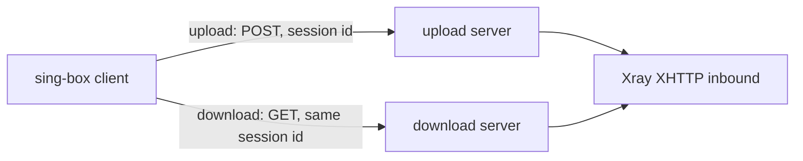

# sing-box-ut

[English](README.md) · **简体中文**

一组补丁，让 sing-box 原生支持 VLESS + XHTTP 客户端和上下行分离，客户端不再需要 xray-core。

[](https://github.com/10ta/sing-box-ut/actions/workflows/build.yml)

目前已经实现的功能，每一项都对真实的 Xray 服务端测过：

- 上行和下行走两台不同的服务器（Xray 的 `downloadSettings`），各有各的地址、TLS 和 XHTTP 选项。
- `stream-up` 和 `packet-up` 两种模式，可走 HTTP/2、HTTP/3（QUIC）和 HTTP/1.1。
- VLESS encryption（`mlkem768x25519plus`）、X-Padding 混淆、XMUX、uTLS 指纹。
- HTTP/3 的拥塞控制可选 BBR 或 Brutal（Xray `finalmask.quicParams` 的 `force-brutal`）。

## 目录

- [为什么是 sing-box-ut？](#-为什么是-sing-box-ut)
- [快速开始](#-快速开始)
- [安装](#-安装)
- [使用](#-使用)
- [配置](#-配置)
- [更新与维护](#-更新与维护)
- [工作原理](#-工作原理)
- [项目结构](#-项目结构)
- [开发](#-开发)
- [局限与路线](#-局限与路线)
- [上游与差异](#-上游与差异)
- [文档地图](#-文档地图)
- [许可](#-许可)

## 💡 为什么是 sing-box-ut？

Xray 的 XHTTP 可以把上行发到一台服务器、下行发到另一台（`downloadSettings`）。没有哪个 sing-box 构建支持这一点，所以需要它的 sing-box 客户端只能在旁边再跑一个 xray-core。本仓库用最新的 sing-box alpha，加上 [sing-box-lx](https://github.com/Leadaxe/sing-box-lx) 的 XHTTP 客户端和 VLESS encryption，再补上缺的上下行分离，构建出成品。

- ✅ 适合：sing-box 客户端通过 VLESS + XHTTP 连接 Xray 服务端，用不用 `downloadSettings` 都可以。
- ❌ 不适合：需要 Vision flow（暂时不支持 `xtls-rprx-vision`）；需要 XHTTP 服务端（只有客户端，服务端继续用 Xray）；想在 `stream-one` 模式下分离下行。

## 🚀 快速开始

在 Linux 上从源码构建。需要 git、bash、python3，以及上游构建所用的 Go 版本（`v1.15.0-alpha.13` 对应 1.26.10）。

```bash
git clone https://github.com/10ta/sing-box-ut
cd sing-box-ut
scripts/prepare.sh work
scripts/build.sh work sing-box
./sing-box version
```

`prepare.sh` 用 `upstream.ref` 里的 sing-box tag 和 `lx.ref` 里的 sing-box-lx 提交，在 `work/` 里拼出源码。最后一条命令打印版本号，以 `-ut` 结尾：

```text
sing-box version 1.15.0-alpha.13-ut
```

## 📦 安装

编译好的文件挂在每个 [release](https://github.com/10ta/sing-box-ut/releases) 上，每次构建一个 prerelease：`<tag>-ut`，同一个 sing-box tag 之后的构建依次为 `<tag>-ut.2`、`<tag>-ut.3`……包管理器能正确排序，升级时总会选到最新的那个。所有文件都按 `sing-box_<版本>_<系统>_<架构>.<扩展名>` 命名。

| 文件 | 用途 |
|---|---|
| `sing-box_<version>_linux_amd64.deb`、`…_arm64.deb` | Debian 和 Ubuntu。包名和文件布局与官方 `sing-box` 包相同，安装后替换官方包。包含 naive 出站需要的 `/usr/lib/libcronet.so` |
| `sing-box_<version>_linux_amd64.tar.gz`、`…_arm64.tar.gz` | 任何带 glibc 的 Linux：`sing-box` 和 `libcronet.so` 在同一个目录里，免安装 |
| `sing-box_<version>_windows_amd64.zip`、`…_arm64.zip` | Windows：一个文件夹，里面是 `sing-box.exe` 和 naive 出站需要的 `libcronet.dll`（两者要放在一起） |
| `sing-box_<version>_android_arm64.apk` | Android：sing-box for Android（SFA），内核换成打过补丁的，适用于 arm64-v8a 设备 |

Android 应用沿用官方的 application id，所以不能和官方 SFA 同时安装，两者之间切换要先卸载。文件名以 `_throwaway-key` 结尾的 APK 是用一次性密钥签的，不能覆盖升级。

## 🧭 使用

### 对接真实的 Xray 服务端验证构建

需要 bash、python3、curl 和 unzip，并且 127.0.0.1 上的 1080、6501、6502、8000 端口空闲。

```bash
curl -fsSL -o xray.zip https://github.com/XTLS/Xray-core/releases/download/v26.11.9/Xray-linux-64.zip
unzip -q xray.zip xray -d xray-bin
test/interop/run.sh ./sing-box xray-bin/xray
```

每个用例通过代理取回一个 5 MB 的文件，并检查下行请求确实走了第二个地址。`plain` 是明文 HTTP/1.1。`full` 同时启用 TLS 1.3、HTTP/2、uTLS、VLESS encryption、X-Padding 混淆和 XMUX。`h3` 是走 HTTP/3 的 `full`。`brutal` 是 `h3` 加上 `quic_params`（上行 Brutal、下行 BBR），并检查客户端日志里 Brutal 确实在跑。预期输出：

```text
== stream-up / plain
ok: payload intact, 1 connection(s) via the download server
== packet-up / plain
ok: payload intact, 1 connection(s) via the download server
== stream-up / full
ok: payload intact, 1 connection(s) via the download server
== packet-up / full
ok: payload intact, 1 connection(s) via the download server
== stream-up / h3
ok: payload intact, 1 connection(s) via the download server
== packet-up / h3
ok: payload intact, 1 connection(s) via the download server
== stream-up / brutal
ok: payload intact, 1 connection(s) via the download server
PASS
```

### 为其他平台构建，或打 .deb 包

```bash
env GOOS=windows GOARCH=arm64 scripts/build.sh work sing-box.exe
scripts/package-deb.sh work sing-box amd64 1.15.0-alpha.13-ut sing-box_amd64.deb
```

## 🔧 配置

相对 sing-box-lx 的 XHTTP 配置，多了两个对象：XHTTP transport 里的 `download`（上下行分离）和 `quic_params`（HTTP/3 拥塞控制）。每个字段的默认值和行为写在[完整示例](#完整示例)的注释里。sing-box 接受 `//` 注释，示例可以直接用。把 `<…>` 占位符换成自己的值。

### 最小示例

能连上 [`examples/xray-server.json`](examples/xray-server.json) 那个服务端的最少字段：

```jsonc
{
  "type": "vless",
  "tag": "xhttp",
  "server": "up.example.com",
  "server_port": 443,
  "uuid": "<UUID>",
  "encryption": "<VLESS_ENCRYPTION>", // 服务端 decryption 为 "none" 时不写
  "tls": {
    "enabled": true,
    "server_name": "up.example.com"   // 不写 alpn：HTTP/2
  },
  "transport": {
    "type": "xhttp",                  // 不写 mode：auto = packet-up
    "path": "/<SECRET_PATH>/",
    // 和服务端的 xPadding* 一致（placement 默认就是 queryInHeader）
    "x_padding_obfs_mode": true,
    "x_padding_key": "<PADDING_KEY>",
    "x_padding_header": "X-Cache",
    "x_padding_method": "tokenish"
  }
}
```

### 完整示例

所有能生效的字段都写上了，并注明默认值；只在别的模式或搭配下才生效的字段以注释列出。这里上行走 HTTP/3 经 CDN 并开 Brutal，下行走 HTTP/2 直连另一台服务器。文件版：[`examples/sing-box-client.jsonc`](examples/sing-box-client.jsonc)。

```jsonc
{
  "type": "vless",
  "tag": "xhttp-split",
  "server": "up.example.com",
  "server_port": 443,
  "uuid": "<UUID>",
  // = 服务端的 "decryption"；那边是 "none" 时不写
  "encryption": "<VLESS_ENCRYPTION>",
  // "flow"：不支持（没有 Vision）
  // 默认 "xudp"；也可 "packetaddr"，或 "" 表示不用
  "packet_encoding": "xudp",
  // 拨号字段（detour、bind_interface 等）照常可用，上下行两半共用
  "tls": {
    "enabled": true,
    "server_name": "up.example.com",
    // 决定 HTTP 版本：恰好 ["h3"] = HTTP/3（QUIC，服务器要能走 UDP），
    // 恰好 ["http/1.1"] = HTTP/1.1，其余 = HTTP/2；REALITY 总是 HTTP/2
    "alpn": ["h3"],
    "min_version": "1.3"
    // "utls"：HTTP/3 上不生效（QUIC 用 Chrome 指纹，日志有警告）
    // "ech"：HTTP/3 上不支持
  },
  "transport": {
    "type": "xhttp",
    // auto | packet-up | stream-up | stream-one
    // auto = packet-up（REALITY：stream-one）；有 "download" 时 = packet-up（REALITY：stream-up）
    // stream-one 不能配 "download"
    "mode": "stream-up",
    // 原样发送（结尾的 / 要留着）；"?" 之后的部分作为 query
    "path": "/<SECRET_PATH>/",
    // 默认取 tls.server_name，没有则用服务器地址
    "host": "up.example.com",
    // 附加请求头。不写 User-Agent：自动补 Chrome 风格的请求头；
    // "User-Agent": "golang"：什么都不补；其他 User-Agent：原样发送，不补
    "headers": {},
    // 默认 "100-1000"；必须落在服务端 xPaddingBytes 范围内
    "x_padding_bytes": "92-1254",
    // 下面的 x_padding_* 要和服务端的 xPadding* 一致
    // 默认 false（padding 放在 Referer 的 query 里，旧方式）；true 启用后面四项
    "x_padding_obfs_mode": true,
    "x_padding_key": "<PADDING_KEY>",       // 默认 "x_padding"；placement 为 header 时不用
    "x_padding_header": "X-Cache",          // 默认 "X-Padding"
    "x_padding_placement": "queryInHeader", // 默认值；或 cookie | header | query
    "x_padding_method": "tokenish",         // 默认 "repeat-x"
    // session id 放哪，要和服务端一致：path（默认）| query | header | cookie
    "session_placement": "path",
    // "session_key": "X-Session",   // placement 不是 path 时用；默认 X-Session（header）、x_session（query、cookie）
    // session id 的字符表和长度，要么都写要么都不写；默认是带横杠的 UUID
    // "session_table": "Base62",    // ASCII 字符表，或 hex HEX number alphabet Alphabet ALPHABET base36 BASE36 Base62
    // "session_length": "16-24",    // len(字符表)^最小长度 要大于 2^31
    // 默认 "POST"；"GET" 只能用于 packet-up（其他模式退回 POST 并警告）
    "uplink_http_method": "POST",
    // 默认 false：流式请求体（stream-up、stream-one）带 Content-Type: application/grpc，
    // CDN 和反代因此不缓冲
    "no_grpc_header": false,
    // 只用于 packet-up：
    // "seq_placement": "path",             // path | query | header | cookie，要和服务端一致
    // "seq_key": "X-Seq",                   // placement 不是 path 时用；默认 X-Seq（header）、x_seq（query、cookie）
    // "uplink_data_placement": "auto",     // auto（= body）| body | header | cookie
    // "uplink_data_key": "X-Data",          // header/cookie 承载数据时的名字；默认 X-Data（header）、x_data（cookie）
    // "uplink_chunk_size": "3000-4000",     // header/cookie 分块大小；默认 header 3000-4000、cookie 2048-3072
    // "sc_max_each_post_bytes": "1000000",  // 单个上行 POST 上限，默认 1000000
    // "sc_min_posts_interval_ms": "30",     // 上行 POST 最小间隔，默认 30
    // HTTP 连接复用。不写或 {}：max_connections 3、h_max_request_times 600-900、
    // h_max_reusable_secs 1800-3000。写了任何一项，其余没写的范围都是不限
    // 范围写法："min-max"、一个数或 [min, max]，每条连接只随机一次
    "xmux": {
      "max_concurrency": "8-16",            // 每条连接承载的流数
      // "max_connections": "3",            // 连接池的连接数；不能和 max_concurrency 同时写
      "c_max_reuse_times": 0,               // 一条连接被复用的次数；0 = 不限
      "h_max_request_times": "600-900",     // 每条连接的 HTTP 请求数
      "h_max_reusable_secs": "1800-3000",   // 连接可复用的秒数
      "h_keep_alive_period": 30             // 保活间隔，秒；0 = 默认（HTTP/2 45、HTTP/3 10）；负数 = 关
    },
    // 只对 HTTP/3（alpn ["h3"]）生效，其他版本警告并忽略。对应 Xray 的 finalmask.quicParams。
    // 只管客户端发出的包，所以写在这里就是加速上行
    "quic_params": {
      // "" = quic-go 默认（Xray 默认是 bbr）| bbr | brutal（Xray 写作 force-brutal）
      "congestion": "brutal",
      // brutal 必填：发送速率，Mbps（Xray：brutalUp "60 mbps"）；填真实上行带宽
      "up_mbps": 60,
      // "bbr_profile": "standard",  // 只用于 bbr：standard（默认）| conservative | aggressive
      "brutal_debug": false          // 只用于 brutal：在 debug 日志里打印 ACK 和丢包率
    },
    // 下行那一半（Xray 的 downloadSettings）。不从上行继承任何一项：
    // 除 mode 和 download 外的所有 transport 字段都能写在这里，默认值同上
    "download": {
      "server": "down.example.com", // 必填
      "server_port": 443,           // 必填
      // 不写就是明文
      "tls": {
        "enabled": true,
        "server_name": "down.example.com",
        "alpn": ["h2", "http/1.1"],
        "min_version": "1.3",
        "utls": {
          "enabled": true,
          "fingerprint": "ios"
        }
      },
      "path": "/<SECRET_PATH>/",
      "x_padding_bytes": "92-1254",
      "x_padding_obfs_mode": true,
      "x_padding_key": "<PADDING_KEY>",
      "x_padding_header": "X-Cache",
      "x_padding_placement": "queryInHeader",
      "x_padding_method": "tokenish",
      "xmux": {
        "max_concurrency": "8-16",
        "c_max_reuse_times": 0,
        "h_max_request_times": "600-900",
        "h_max_reusable_secs": "1800-3000",
        "h_keep_alive_period": 30
      }
      // "quic_params"：可以写，用处不大：客户端在这边只发请求和 ACK
      // "uuid"、"encryption"、"flow"：会报错；出站本身的 VLESS 设置管两半
    }
  }
}
```

对应的服务端在 [`examples/`](examples/) 里：[`xray-server.json`](examples/xray-server.json)（一个 Xray inbound）和 [`Caddyfile`](examples/Caddyfile)（在它前面做 TLS 终结，两台服务器都用）。两份客户端示例每次构建都由 `test/check-examples.py` 跑 `sing-box check`，并核对和两份 README 里的一致；服务端示例通过了 `xray run -test`；Caddyfile 本文档的作者没有实际运行过。

### HTTP/3

上下行各自的 `alpn` 决定 HTTP 版本，可以只有一边走 HTTP/3。服务器必须能通过 UDP 访问：Caddy 在与 HTTPS 端口同号的 UDP 端口上提供 HTTP/3，转发给 Xray 时仍然是 h2c，所以 Caddyfile 不用改。

### 没有对应项的 Xray 设置

| Xray 客户端设置 | 这里 |
|---|---|
| `flow: xtls-rprx-vision` | 暂时不支持。两端都不要配 |
| `finalmask.quicParams` | 只支持拥塞控制（`congestion`、`brutalUp`、`bbrProfile`、`debug`），即 `quic_params`。接收窗口、`udpHop` 等其他项不支持 |
| `finalmask.udp`（noise） | 不支持 |
| `testpre` | 不支持 |
| `xhttpSettings` 里只对服务端有用的 `noSSEHeader`、`scMaxBufferedPosts`、`scStreamUpServerSecs`、`serverMaxHeaderBytes`，以及旧的 `scMaxConcurrentPosts` | 写了不报错，但不生效 |
| `downloadSettings` 里的 `id`、`encryption`、`flow`、`testpre` | 去掉：`download` 遇到不认识的字段会报错。它们是 VLESS 的设置，不是传输层设置，Xray 在这个位置也会忽略它们。见下 |

为什么 `download` 里没有 `uuid` 和 `encryption`：两台服务器承载的是同一条连接的两半，不是两条连接。客户端只在隧道里做一次 VLESS 握手（UUID、encryption），Xray 的 inbound 先按 session id 把上行和下行请求拼起来，再读这次握手。所以两台服务器最终必须通到同一个 Xray inbound，VLESS 设置也只有一组，写在出站本身。

## 🔄 更新与维护

### 更新是怎么发生的

`main` 上只放验证通过的组合。两个文件钉住每个提交构建的内容：`upstream.ref`（一个 sing-box tag）和 `lx.ref`（一个 sing-box-lx 提交）。`update` workflow 每天：

1. 在 `main` 之上试更新的 sing-box tag。
2. 试更新的 sing-box-lx 提交。如果本项目复制的文件都没变，只提交新的 `lx.ref`，不构建。
3. 最新的 release 没有 APK 时，补编 APK。

试验的变化只有在单元测试、Linux 和 Windows 构建、Xray 互通测试全部通过后，才会成为 `main` 上的提交并发布。失败的不会动 `main` 和已发布的版本，会发一条 Telegram 消息，并开一个标签为 `auto-update` 的 issue，写明试了什么、哪些 job 失败、相关的日志行。sing-box 的更新失败不会挡住 sing-box-lx 的更新，反之亦然。

| Release | 对应的构建 |
|---|---|
| `v1.15.0-alpha.13-ut` | 一个 sing-box tag 的第一次构建 |
| `v1.15.0-alpha.13-ut.2`、`.3`、… | 同一个 tag 的后续构建：sing-box-lx 更新，或本仓库的改动 |

### 更新失败时

把 issue 链接交给修复的人。修复推到 `main` 之后，下一次每日更新会重试同一个变化；关闭 issue 也会让它重试。变化通过后 issue 会自动关闭。不想等一天的话，运行 **Actions → update → Run workflow**。

workflow 会自己往 `main` 提交，所以推送自己的改动前先拉取：

```bash
git pull --rebase
```

### sing-box 换小版本

sing-box-lx 每个 sing-box 小版本一个分支（目前是 `lx-1.15`）。sing-box 进入下一个小版本后，更新会一直失败，直到把 `.github/workflows/update.yml` 里的 `LX_BRANCH` 改成 lx 的新分支。

### Xray 出新版本

互通测试钉死了 Xray 版本（`build.yml` 里的 `XRAY_VERSION`），因为服务端默认值会随版本变化。改掉版本号后推送，构建会告诉你测试是否还能通过。

### Secrets

| Secret | 必填 | 用途 |
|---|---|---|
| `ANDROID_KEYSTORE_BASE64` | ❌ | APK 签名用的 keystore 的 Base64。不设的话每次运行用一次性密钥 |
| `ANDROID_KEYSTORE_PASS` | 配了 keystore 就必填 | keystore 密码 |
| `ANDROID_KEY_ALIAS`、`ANDROID_KEY_PASS` | ❌ | 密钥别名（默认取 keystore 里的第一个密钥）和密钥密码（默认同 keystore 密码） |
| `TG_BOT_TOKEN`、`TG_CHAT_ID` | ❌ | 每次构建后发 Telegram 汇总，成功失败都发 |

`scripts/make-keystore.sh` 用 openssl 生成 keystore，并打印要保存的两个值。keystore 要留好：丢了的话，以后的 APK 无法覆盖升级已安装的版本。

仓库 60 天没有活动时，GitHub 会停用定时 workflow，需要到 Actions 页面重新启用。

## 🧠 工作原理



- **钉住版本，不靠分支** → `upstream.ref` 和 `lx.ref` 确定每个提交构建什么，每日更新只在全部检查通过后才移动它们，所以 `main` 上始终是测过的组合。
- **用上游源码，不 fork** → 每次构建都从原样的 sing-box tag 开始，没有合并要维护。文件从 sing-box-lx 复制进来，再用两个小补丁接上。
- **下行端点就是第二个 XHTTP 客户端** → 请求构造的所有规则（padding、placement、headers、HTTP 版本）直接复用，连接池各用各的。
- **两条池化连接一起释放** → 连接关闭或失败时，两个池都不会漏掉占用。

## 📁 项目结构

```text
.
├── upstream.ref              # the sing-box tag the build starts from
├── lx.ref                    # the sing-box-lx commit the build copies files from
├── lx-files.txt              # which sing-box-lx files are copied
├── patches/
│   ├── 0001-upstream-seams.patch      # hooks XHTTP and VLESS encryption into upstream files
│   ├── 0002-lx-xhttp-download.patch   # the download endpoint, on the copied lx files
│   └── 0003-xhttp-quic-params.patch   # quic_params (QUIC congestion control), on the copied lx files
├── overlay/                  # our own files, copied over the tree (libbox build tag)
├── scripts/
│   ├── prepare.sh            # assembles the source tree
│   ├── lx-files.py           # applies lx-files.txt to a list of lx paths
│   ├── build.sh              # compiles sing-box from it
│   ├── fetch-cronet.sh       # downloads the library the naive outbound needs
│   ├── package-deb.sh        # packs a .deb
│   ├── android-client.sh     # checks out the matching Android client
│   ├── make-keystore.sh      # creates the APK signing keystore, once
│   ├── go-version.sh         # the Go version upstream builds with
│   ├── auto-update.sh        # decides what the daily update tries
│   ├── lx-diff.sh            # did a new lx commit change the copied files?
│   ├── next-release-tag.sh   # <tag>-ut, <tag>-ut.2, …
│   ├── report-issue.sh       # the issue opened when a build fails
│   └── notify-telegram.sh    # the Telegram summary
├── test/interop/             # runs the client against a real Xray server
├── examples/                 # complete configs: sing-box client, Xray server, Caddyfile
├── .github/workflows/
│   ├── build.yml             # test, build, promote to main, release
│   └── update.yml            # the daily update
├── docs/NOTES.zh-CN.md       # research, decisions and pitfalls (Chinese)
└── AGENTS.md                 # commands and conventions for AI coding agents
```

## 🔨 开发

在拼好的源码树里跑补丁涉及的包的单元测试：

```bash
cd work
go vet -tags "with_quic,with_utls,with_xhttp,badlinkname,tfogo_checklinkname0" ./option/ ./transport/v2rayxhttp/ ./protocol/vless/...
go test -count=1 -tags "with_quic,with_utls,with_xhttp,badlinkname,tfogo_checklinkname0" ./option/ ./transport/v2rayxhttp/
```

两个测试包都显示 `ok`。要改下行或 `quic_params` 的逻辑，先改 `work/` 里的文件，再按 [AGENTS.md](AGENTS.md) 的说明重新生成对应的补丁。加进 lx 文件的行都带 `// ut:` 标记；新代码放在 `*_ut.go` 文件里。

## 🚧 局限与路线

- 暂时不支持 Vision flow；QUIC 只能选拥塞控制，不能调窗口，见[配置](#-配置)。
- Linux 和 Windows 的构建带上游的全部功能，包括 naive 出站。自己手动编出的二进制要启动 naive 出站，需要把 `libcronet.so` 放在它旁边、`LD_LIBRARY_PATH` 里或 `/usr/lib` 下（`scripts/fetch-cronet.sh work linux amd64 .`）。
- 自动化测试跑在 Linux amd64 上，对接的是自己做 TLS 终结的 Xray。发布的 Linux 和 Android 构建也在真实的双服务器部署（前面是 Caddy）上跑通了。没测过：CDN、下行端点用 REALITY、经 detour 拨号、Windows 构建。
- 只有客户端。sing-box-lx 没有 XHTTP 服务端。

## 🔀 上游与差异

用 [SagerNet/sing-box](https://github.com/SagerNet/sing-box) 在 `upstream.ref` 里的 tag 构建（撰写时为 `v1.15.0-alpha.13`），文件取自 [Leadaxe/sing-box-lx](https://github.com/Leadaxe/sing-box-lx) 在 `lx.ref` 里的那个提交。

| 方面 | sing-box | sing-box-lx | 本仓库 |
|---|---|---|---|
| XHTTP 客户端 | ❌ | ✅ | ✅ |
| VLESS encryption | ❌ | ✅ | ✅ |
| 下行走另一台服务器 | ❌ | ❌ | ✅ |
| HTTP/3 拥塞控制（BBR、Brutal） | ❌ | ❌ | ✅ |
| sing-box-lx 的其他改动 | ❌ | ✅ | ❌ |

与两者的同步都是自动的，见[更新与维护](#-更新与维护)。

## 📚 文档地图

- [AGENTS.md](AGENTS.md)：给 AI 编码代理的命令、约定和注意事项。
- [docs/NOTES.zh-CN.md](docs/NOTES.zh-CN.md)：候选实现的调研、设计决策、测试记录和踩过的坑（中文）。

## 📄 许可

[GPL-3.0-or-later](LICENSE)。补丁修改的是 sing-box 和 sing-box-lx 的源码，它们用的是同一个许可证。
