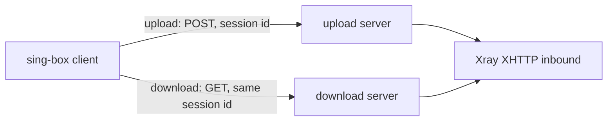

# sing-box-ut

[English](README.md) · **简体中文**

一组补丁，让 sing-box 原生支持 VLESS + XHTTP 客户端和上下行分离，客户端不再需要 xray-core。

[](https://github.com/10ta/sing-box-ut/actions/workflows/verify-download.yml)

目前已经实现的功能，每一项都对真实的 Xray 服务端测过：

- 上行和下行走两台不同的服务器（Xray 的 `downloadSettings`），各有各的地址、TLS 和 XHTTP 选项。
- `stream-up` 和 `packet-up` 两种模式，可走 HTTP/2、HTTP/3（QUIC）和 HTTP/1.1。
- VLESS encryption（`mlkem768x25519plus`）、X-Padding 混淆、XMUX、uTLS 指纹。

## 目录

- [为什么是 sing-box-ut？](#-为什么是-sing-box-ut)
- [快速开始](#-快速开始)
- [使用](#-使用)
- [配置](#-配置)
- [更新与维护](#-更新与维护)
- [工作原理](#-工作原理)
- [项目结构](#-项目结构)
- [开发](#-开发)
- [局限与路线](#-局限与路线)
- [上游与差异](#-上游与差异)
- [文档地图](#-文档地图)
- [许可](#-许可)

## 💡 为什么是 sing-box-ut？

Xray 的 XHTTP 可以把上行发到一台服务器、下行发到另一台（`downloadSettings`）。没有哪个 sing-box 构建支持这一点，所以需要它的 sing-box 客户端只能在旁边再跑一个 xray-core。本仓库把缺的这一块做成补丁，打在 [sing-box-lx](https://github.com/Leadaxe/sing-box-lx) 上，它已经有 XHTTP 客户端和 VLESS encryption。

- ✅ 适合：sing-box 客户端通过 VLESS + XHTTP 连接 Xray 服务端，并且用了 `downloadSettings`。
- ❌ 不适合：想要现成的二进制（目前不发布，见[局限与路线](#-局限与路线)）；需要 XHTTP 服务端（只有客户端，服务端继续用 Xray）；想在 `stream-one` 模式下分离下行。

## 🚀 快速开始

需要 Linux 上的 git 和 Go 1.26 或更新版本。

```bash
git clone https://github.com/10ta/sing-box-ut
cd sing-box-ut
git clone --depth 1 -b lx-1.15 --recurse-submodules --shallow-submodules https://github.com/Leadaxe/sing-box-lx lx
git -C lx apply ../patches/0002-lx-xhttp-download.patch
cd lx
env CGO_ENABLED=0 go build -trimpath -tags "with_quic,with_utls,with_clash_api,with_xhttp,badlinkname,tfogo_checklinkname0" -ldflags "-s -w -checklinkname=0" -o ../sing-box ./cmd/sing-box
cd ..
./sing-box version
```

最后一条命令会打印构建标签，其中必须有 `with_xhttp`：

```text
sing-box version unknown

Environment: go1.26.6 linux/amd64
Tags: with_quic,with_utls,with_clash_api,with_xhttp,badlinkname,tfogo_checklinkname0
```

## 🧭 使用

### 对接真实的 Xray 服务端做验证

需要 bash、python3、curl 和 unzip，并且 127.0.0.1 上的 1080、6501、6502、8000 端口空闲。

```bash
curl -fsSL -o xray.zip https://github.com/XTLS/Xray-core/releases/download/v26.11.9/Xray-linux-64.zip
unzip -q xray.zip xray -d xray-bin
test/interop/run.sh ./sing-box xray-bin/xray
```

每个用例通过代理取回一个 5 MB 的文件，并检查下行请求确实走了第二个地址。`plain` 是明文 HTTP/1.1。`full` 同时启用 TLS 1.3、HTTP/2、uTLS、VLESS encryption、X-Padding 混淆和 XMUX。`h3` 是走 HTTP/3 的 `full`。预期输出：

```text
== stream-up / plain
ok: payload intact, 1 connection(s) via the download server
== packet-up / plain
ok: payload intact, 1 connection(s) via the download server
== stream-up / full
ok: payload intact, 1 connection(s) via the download server
== packet-up / full
ok: payload intact, 1 connection(s) via the download server
== stream-up / h3
ok: payload intact, 1 connection(s) via the download server
== packet-up / h3
ok: payload intact, 1 connection(s) via the download server
PASS
```

### 在 GitHub Actions 里跑同样的检查

打开 **Actions → verify-download → Run workflow**。推送改到补丁、互通测试或 workflow 时也会自动运行。这个任务把补丁打到 sing-box-lx 上，运行 `gofmt`、`go vet` 和单元测试，编译客户端，再跑互通测试。

## 🔧 配置

补丁只给 VLESS 出站的 XHTTP transport 加了一个对象 `download`，其余都是 sing-box-lx 原有的 XHTTP 配置。

| 名称 | 必填 | 默认值 | 说明 |
|---|---|---|---|
| `download.server` | ✅ | — | 下行服务器地址 |
| `download.server_port` | ✅ | — | 下行服务器端口 |
| `download.tls` | ❌ | 明文 | 下行服务器的出站 TLS 选项 |
| `download.path`、`host`、`headers`、`x_padding_*`、`xmux` 等 | ❌ | transport 默认值 | 下行请求的 XHTTP 选项，不从上行继承任何一项 |
| `download.mode` | ❌ | 上行的 mode | 留空。填了不同的值会报错 |

规则与 Xray 一致：

- 下行请求和上行共用 session id，拨号用出站自己的 dialer（detour、bind）。
- `stream-one` 配 `download` 会报错。`auto` 配 `download` 解析为 `packet-up`，REALITY 下为 `stream-up`。
- `download` 里不能再嵌套 `download`。

### 完整示例

一个 VLESS 出站，上行走 `up.example.com`，下行走 `down.example.com`。它是一份真实 Xray 客户端配置在 sing-box-ut 里的写法。把所有 `<…>` 占位符换成自己的值。

```json
{
  "type": "vless",
  "tag": "xhttp-split",
  "server": "up.example.com",
  "server_port": 443,
  "uuid": "<UUID_FOR_SING_BOX_UT>",
  "encryption": "<VLESS_ENCRYPTION>",
  "tls": {
    "enabled": true,
    "server_name": "up.example.com",
    "alpn": ["h2", "http/1.1"],
    "min_version": "1.3",
    "utls": { "enabled": true, "fingerprint": "ios" }
  },
  "transport": {
    "type": "xhttp",
    "mode": "stream-up",
    "path": "/<SECRET_PATH>/",
    "x_padding_bytes": "92-1254",
    "x_padding_obfs_mode": true,
    "x_padding_method": "tokenish",
    "x_padding_placement": "queryInHeader",
    "x_padding_key": "<PADDING_KEY>",
    "x_padding_header": "X-Cache",
    "xmux": {
      "max_concurrency": "8-16",
      "c_max_reuse_times": 0,
      "h_max_request_times": "600-900",
      "h_max_reusable_secs": "1800-3000",
      "h_keep_alive_period": 30
    },
    "download": {
      "server": "down.example.com",
      "server_port": 443,
      "tls": {
        "enabled": true,
        "server_name": "down.example.com",
        "alpn": ["h2", "http/1.1"],
        "min_version": "1.3",
        "utls": { "enabled": true, "fingerprint": "ios" }
      },
      "path": "/<SECRET_PATH>/",
      "x_padding_bytes": "92-1254",
      "x_padding_obfs_mode": true,
      "x_padding_method": "tokenish",
      "x_padding_placement": "queryInHeader",
      "x_padding_key": "<PADDING_KEY>",
      "x_padding_header": "X-Cache",
      "xmux": {
        "max_concurrency": "8-16",
        "c_max_reuse_times": 0,
        "h_max_request_times": "600-900",
        "h_max_reusable_secs": "1800-3000",
        "h_keep_alive_period": 30
      }
    }
  }
}
```

对应的服务端在 [`examples/`](examples/) 里：[`xray-server.json`](examples/xray-server.json)（一个 Xray inbound）和 [`Caddyfile`](examples/Caddyfile)（在它前面做 TLS 终结，两台服务器都用）。客户端和服务端示例通过了 `sing-box check` 和 `xray run -test`；Caddyfile 本文档的作者没有实际运行过。

### HTTP/3

把 `tls` 和 `download.tls` 里的 `alpn` 改成 `["h3"]`，并去掉 `utls`（指纹对 QUIC 不生效）。上下行互相独立，可以只改其中一边。服务器必须能通过 UDP 访问：Caddy 在与 HTTPS 端口同号的 UDP 端口上提供 HTTP/3，转发给 Xray 时仍然是 h2c，所以 Caddyfile 不用改。

### 没有对应项的 Xray 设置

| Xray 客户端设置 | 这里 |
|---|---|
| `flow: xtls-rprx-vision` | 不支持。服务端不能要求这个客户端带 flow：在 `clients` 里给它单独一项且不写 `flow`，`settings` 层也不要写 `flow`，否则 Xray 会拒绝不带 flow 的客户端 |
| `finalmask.quicParams`（拥塞控制、接收窗口） | 不可配置。它只对 HTTP/3 生效；这里的 QUIC 用 quic-go 的默认值 |
| `finalmask.udp`（noise） | 不支持 |
| `testpre` | 不支持 |
| `downloadSettings` 里的 `flow`、`encryption`、`testpre` | 不是传输层设置，直接去掉 |

| Xray `downloadSettings` | 这里 |
|---|---|
| `address`、`port` | `download.server`、`download.server_port` |
| `security`、`tlsSettings` | `download.tls` |
| `xhttpSettings.*` | `download.*`，改为 snake_case，例如 `xPaddingBytes` → `x_padding_bytes` |

## 🔄 更新与维护

### sing-box-lx 更新时

workflow 跟的是 `lx-1.15` 分支的最新提交。如果 lx 改到了补丁涉及的行，“Apply the download patch” 这一步会失败。在一个新的 lx clone 里重做补丁：

```bash
git -C lx apply --reject ../patches/0002-lx-xhttp-download.patch
# fix every *.rej by hand, delete them, then:
git -C lx add -A
git -C lx diff --cached > patches/0002-lx-xhttp-download.patch
```

### Xray 发新版本时

互通测试钉死了 Xray 版本（workflow 里的 `XRAY_VERSION`），因为服务端默认值会随版本变化。要换版本，先手动运行 workflow 并在 `xray_version` 输入框填新 tag，通过后再改默认值。

## 🧠 工作原理



- **下行端点就是第二个 XHTTP 客户端** → 请求构造的所有规则（padding、placement、headers、HTTP 版本）直接复用，连接池各用各的，sing-box-lx 原有文件只改了约 70 行。
- **两条池化连接一起释放** → 连接关闭或失败时，两个池都不会漏掉占用。
- **用补丁，不 fork** → sing-box-lx 一直在更新。只动它四个文件的补丁维护成本低，打不上时会立刻报错。

## 📁 项目结构

```text
.
├── patches/
│   └── 0002-lx-xhttp-download.patch   # the change: XHTTP download endpoint + unit tests
├── test/interop/
│   ├── run.sh                         # runs every case against a real Xray
│   ├── gen.py                         # writes the Xray and sing-box configs for one case
│   └── tcp_tap.py                     # stands in for the download server, logs what reaches it
├── .github/workflows/
│   └── verify-download.yml            # apply, vet, test, build, interop
├── examples/                          # complete configs: sing-box client, Xray server, Caddyfile
├── docs/NOTES.zh-CN.md                # research, decisions and pitfalls (Chinese)
└── AGENTS.md                          # commands and conventions for AI coding agents
```

补丁在 sing-box-lx 里改动的文件：

| 文件 | 改动 |
|---|---|
| `option/v2ray_xhttp.go` | 加 `download` 字段 |
| `option/v2ray_xhttp_download_ut.go` | 新增：`download` 的选项类型 |
| `transport/v2rayxhttp/client.go` | 构建下行端点，确定 mode |
| `transport/v2rayxhttp/conn.go` | 下行 GET 改走下行端点 |
| `transport/v2rayxhttp/xmux.go` | 下行连接随上行连接一起释放 |
| `transport/v2rayxhttp/download_ut.go` | 新增：下行端点的逻辑 |
| `transport/v2rayxhttp/download_ut_test.go` | 新增：单元测试 |

## 🔨 开发

在[快速开始](#-快速开始)里打好补丁的 `lx` 目录中运行：

```bash
gofmt -l option/v2ray_xhttp*.go transport/v2rayxhttp/
go vet -tags "with_quic,with_utls,with_clash_api,with_xhttp,badlinkname,tfogo_checklinkname0" ./option/ ./transport/v2rayxhttp/
go test -count=1 -race -tags "with_quic,with_utls,with_clash_api,with_xhttp,badlinkname,tfogo_checklinkname0" ./option/ ./transport/v2rayxhttp/
```

`gofmt` 没有输出，两个测试包都显示 `ok`。补丁加进 lx 文件的行都带 `// ut:` 标记。新代码尽量放在 `*_ut.go` 文件里，让补丁碰到的 lx 原有行越少越好。

## 🚧 局限与路线

- 不发布二进制。跟随 sing-box 最新 alpha 自动构建 Linux `.deb` 和 Android APK 的流水线，设计写在 [docs/NOTES.zh-CN.md](docs/NOTES.zh-CN.md) 里，还没有放进本仓库。
- 只在 Linux amd64 上测过，并且是 Xray 自己做 TLS 终结。没测过：Xray 前面放 Caddy、CDN、下行端点用 REALITY、经 detour 拨号、Android。
- 不支持 Vision flow，也不能调 QUIC 的拥塞控制和窗口，见[配置](#-配置)。
- 只有客户端。sing-box-lx 没有 XHTTP 服务端。

## 🔀 上游与差异

基于 [Leadaxe/sing-box-lx](https://github.com/Leadaxe/sing-box-lx) 的 `lx-1.15` 分支（`20723b7`），它合并了 [SagerNet/sing-box](https://github.com/SagerNet/sing-box) 的 `v1.15.0-alpha.13`。

| 方面 | sing-box | sing-box-lx | 本仓库 |
|---|---|---|---|
| XHTTP 客户端 | ❌ | ✅ | ✅ |
| VLESS encryption | ❌ | ✅ | ✅ |
| 下行走另一台服务器 | ❌ | ❌ | ✅ |

同步方式是手动：补丁打不上时 workflow 会报出来，见[更新与维护](#-更新与维护)。

## 📚 文档地图

- [AGENTS.md](AGENTS.md)：给 AI 编码代理的命令、约定和注意事项。
- [docs/NOTES.zh-CN.md](docs/NOTES.zh-CN.md)：候选实现的调研、设计决策、测试记录和踩过的坑（中文）。

## 📄 许可

[GPL-3.0-or-later](LICENSE)。补丁修改的是 sing-box 和 sing-box-lx 的源码，它们用的是同一个许可证。
