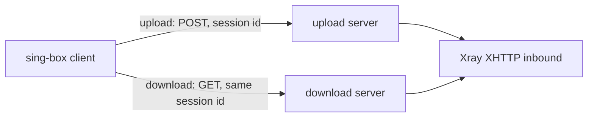

# sing-box-ut

[English](README.md) · **简体中文**

一组补丁，让 sing-box 原生支持 VLESS + XHTTP 客户端和上下行分离，客户端不再需要 xray-core。

[](https://github.com/10ta/sing-box-ut/actions/workflows/build.yml)

目前已经实现的功能，每一项都对真实的 Xray 服务端测过：

- 上行和下行走两台不同的服务器（Xray 的 `downloadSettings`），各有各的地址、TLS 和 XHTTP 选项。
- `stream-up` 和 `packet-up` 两种模式，可走 HTTP/2、HTTP/3（QUIC）和 HTTP/1.1。
- VLESS encryption（`mlkem768x25519plus`）、X-Padding 混淆、XMUX、uTLS 指纹。

## 目录

- [为什么是 sing-box-ut？](#-为什么是-sing-box-ut)
- [快速开始](#-快速开始)
- [安装](#-安装)
- [使用](#-使用)
- [配置](#-配置)
- [更新与维护](#-更新与维护)
- [工作原理](#-工作原理)
- [项目结构](#-项目结构)
- [开发](#-开发)
- [局限与路线](#-局限与路线)
- [上游与差异](#-上游与差异)
- [文档地图](#-文档地图)
- [许可](#-许可)

## 💡 为什么是 sing-box-ut？

Xray 的 XHTTP 可以把上行发到一台服务器、下行发到另一台（`downloadSettings`）。没有哪个 sing-box 构建支持这一点，所以需要它的 sing-box 客户端只能在旁边再跑一个 xray-core。本仓库用最新的 sing-box alpha，加上 [sing-box-lx](https://github.com/Leadaxe/sing-box-lx) 的 XHTTP 客户端和 VLESS encryption，再补上缺的上下行分离，构建出成品。

- ✅ 适合：sing-box 客户端通过 VLESS + XHTTP 连接 Xray 服务端，用不用 `downloadSettings` 都可以。
- ❌ 不适合：需要 Vision flow（暂时不支持 `xtls-rprx-vision`）；需要 XHTTP 服务端（只有客户端，服务端继续用 Xray）；想在 `stream-one` 模式下分离下行。

## 🚀 快速开始

在 Linux 上从源码构建。需要 git、bash、python3，以及上游构建所用的 Go 版本（`v1.15.0-alpha.13` 对应 1.26.10）。

```bash
git clone https://github.com/10ta/sing-box-ut
cd sing-box-ut
scripts/prepare.sh work
scripts/build.sh work sing-box
./sing-box version
```

`prepare.sh` 用 `upstream.ref` 里的 sing-box tag 和 `lx.ref` 里的 sing-box-lx 提交，在 `work/` 里拼出源码。最后一条命令打印版本号，以 `-ut` 结尾：

```text
sing-box version 1.15.0-alpha.13-ut
```

## 📦 安装

编译好的文件挂在每个 [release](https://github.com/10ta/sing-box-ut/releases) 上，每次构建一个 prerelease：`<tag>-ut`，同一个 sing-box tag 之后的构建依次为 `<tag>-ut.2`、`<tag>-ut.3`……包管理器能正确排序，升级时总会选到最新的那个。所有文件都按 `sing-box_<版本>_<系统>_<架构>.<扩展名>` 命名。

| 文件 | 用途 |
|---|---|
| `sing-box_<version>_linux_amd64.deb`、`…_arm64.deb` | Debian 和 Ubuntu。包名和文件布局与官方 `sing-box` 包相同，安装后替换官方包。包含 naive 出站需要的 `/usr/lib/libcronet.so` |
| `sing-box_<version>_linux_amd64.tar.gz`、`…_arm64.tar.gz` | 任何带 glibc 的 Linux：`sing-box` 和 `libcronet.so` 在同一个目录里，免安装 |
| `sing-box_<version>_windows_amd64.zip`、`…_arm64.zip` | Windows：一个文件夹，里面是 `sing-box.exe` 和 naive 出站需要的 `libcronet.dll`（两者要放在一起） |
| `sing-box_<version>_android_arm64.apk` | Android：sing-box for Android（SFA），内核换成打过补丁的，适用于 arm64-v8a 设备 |

Android 应用沿用官方的 application id，所以不能和官方 SFA 同时安装，两者之间切换要先卸载。文件名以 `_throwaway-key` 结尾的 APK 是用一次性密钥签的，不能覆盖升级。

## 🧭 使用

### 对接真实的 Xray 服务端验证构建

需要 bash、python3、curl 和 unzip，并且 127.0.0.1 上的 1080、6501、6502、8000 端口空闲。

```bash
curl -fsSL -o xray.zip https://github.com/XTLS/Xray-core/releases/download/v26.11.9/Xray-linux-64.zip
unzip -q xray.zip xray -d xray-bin
test/interop/run.sh ./sing-box xray-bin/xray
```

每个用例通过代理取回一个 5 MB 的文件，并检查下行请求确实走了第二个地址。`plain` 是明文 HTTP/1.1。`full` 同时启用 TLS 1.3、HTTP/2、uTLS、VLESS encryption、X-Padding 混淆和 XMUX。`h3` 是走 HTTP/3 的 `full`。预期输出：

```text
== stream-up / plain
ok: payload intact, 1 connection(s) via the download server
== packet-up / plain
ok: payload intact, 1 connection(s) via the download server
== stream-up / full
ok: payload intact, 1 connection(s) via the download server
== packet-up / full
ok: payload intact, 1 connection(s) via the download server
== stream-up / h3
ok: payload intact, 1 connection(s) via the download server
== packet-up / h3
ok: payload intact, 1 connection(s) via the download server
PASS
```

### 为其他平台构建，或打 .deb 包

```bash
env GOOS=windows GOARCH=arm64 scripts/build.sh work sing-box.exe
scripts/package-deb.sh work sing-box amd64 1.15.0-alpha.13-ut sing-box_amd64.deb
```

## 🔧 配置

相对 sing-box-lx 的 XHTTP 配置，只多了一个对象：VLESS 出站的 XHTTP transport 里的 `download`。

| 名称 | 必填 | 默认值 | 说明 |
|---|---|---|---|
| `download.server` | ✅ | — | 下行服务器地址 |
| `download.server_port` | ✅ | — | 下行服务器端口 |
| `download.tls` | ❌ | 明文 | 下行服务器的出站 TLS 选项 |
| `download.path`、`host`、`headers`、`x_padding_*`、`xmux` 等 | ❌ | transport 默认值 | 下行请求的 XHTTP 选项，不从上行继承任何一项 |
| `download.mode` | ❌ | 上行的 mode | 留空。填了不同的值会报错 |

规则与 Xray 一致：

- 下行请求和上行共用 session id，拨号用出站自己的 dialer（detour、bind）。
- `stream-one` 配 `download` 会报错。`auto` 配 `download` 解析为 `packet-up`，REALITY 下为 `stream-up`。
- `download` 里不能再嵌套 `download`。

### 完整示例

一个 VLESS 出站，上行走 `up.example.com`，下行走 `down.example.com`。它是一份真实 Xray 客户端配置在 sing-box-ut 里的写法。把所有 `<…>` 占位符换成自己的值。

```json
{
  "type": "vless",
  "tag": "xhttp-split",
  "server": "up.example.com",
  "server_port": 443,
  "uuid": "<UUID>",
  "encryption": "<VLESS_ENCRYPTION>",
  "tls": {
    "enabled": true,
    "server_name": "up.example.com",
    "alpn": ["h2", "http/1.1"],
    "min_version": "1.3",
    "utls": { "enabled": true, "fingerprint": "ios" }
  },
  "transport": {
    "type": "xhttp",
    "mode": "stream-up",
    "path": "/<SECRET_PATH>/",
    "x_padding_bytes": "92-1254",
    "x_padding_obfs_mode": true,
    "x_padding_method": "tokenish",
    "x_padding_placement": "queryInHeader",
    "x_padding_key": "<PADDING_KEY>",
    "x_padding_header": "X-Cache",
    "xmux": {
      "max_concurrency": "8-16",
      "c_max_reuse_times": 0,
      "h_max_request_times": "600-900",
      "h_max_reusable_secs": "1800-3000",
      "h_keep_alive_period": 30
    },
    "download": {
      "server": "down.example.com",
      "server_port": 443,
      "tls": {
        "enabled": true,
        "server_name": "down.example.com",
        "alpn": ["h2", "http/1.1"],
        "min_version": "1.3",
        "utls": { "enabled": true, "fingerprint": "ios" }
      },
      "path": "/<SECRET_PATH>/",
      "x_padding_bytes": "92-1254",
      "x_padding_obfs_mode": true,
      "x_padding_method": "tokenish",
      "x_padding_placement": "queryInHeader",
      "x_padding_key": "<PADDING_KEY>",
      "x_padding_header": "X-Cache",
      "xmux": {
        "max_concurrency": "8-16",
        "c_max_reuse_times": 0,
        "h_max_request_times": "600-900",
        "h_max_reusable_secs": "1800-3000",
        "h_keep_alive_period": 30
      }
    }
  }
}
```

对应的服务端在 [`examples/`](examples/) 里：[`xray-server.json`](examples/xray-server.json)（一个 Xray inbound）和 [`Caddyfile`](examples/Caddyfile)（在它前面做 TLS 终结，两台服务器都用）。客户端和服务端示例通过了 `sing-box check` 和 `xray run -test`；Caddyfile 本文档的作者没有实际运行过。

### HTTP/3

把 `tls` 和 `download.tls` 里的 `alpn` 改成 `["h3"]`。上下行互相独立，可以只改其中一边。`utls` 指纹在 QUIC 上不生效，日志里会有一条警告。服务器必须能通过 UDP 访问：Caddy 在与 HTTPS 端口同号的 UDP 端口上提供 HTTP/3，转发给 Xray 时仍然是 h2c，所以 Caddyfile 不用改。

### 没有对应项的 Xray 设置

| Xray 客户端设置 | 这里 |
|---|---|
| `flow: xtls-rprx-vision` | 暂时不支持。两端都不要配 |
| `finalmask.quicParams`（拥塞控制、接收窗口） | 不可配置。它只对 HTTP/3 生效；这里的 QUIC 用 quic-go 的默认值 |
| `finalmask.udp`（noise） | 不支持 |
| `testpre` | 不支持 |
| `downloadSettings` 里的 `id`、`encryption`、`flow`、`testpre` | 去掉：`download` 遇到不认识的字段会报错。它们是 VLESS 的设置，不是传输层设置，Xray 在这个位置也会忽略它们。见下 |

为什么 `download` 里没有 `uuid` 和 `encryption`：两台服务器承载的是同一条连接的两半，不是两条连接。客户端只在隧道里做一次 VLESS 握手（UUID、encryption），Xray 的 inbound 先按 session id 把上行和下行请求拼起来，再读这次握手。所以两台服务器最终必须通到同一个 Xray inbound，VLESS 设置也只有一组，写在出站本身。

## 🔄 更新与维护

### 更新是怎么发生的

`main` 上只放验证通过的组合。两个文件钉住每个提交构建的内容：`upstream.ref`（一个 sing-box tag）和 `lx.ref`（一个 sing-box-lx 提交）。`update` workflow 每天：

1. 在 `main` 之上试更新的 sing-box tag。
2. 试更新的 sing-box-lx 提交。如果本项目复制的文件都没变，只提交新的 `lx.ref`，不构建。
3. 最新的 release 没有 APK 时，补编 APK。

试验的变化只有在单元测试、Linux 和 Windows 构建、Xray 互通测试全部通过后，才会成为 `main` 上的提交并发布。失败的不会动 `main` 和已发布的版本，会发一条 Telegram 消息，并开一个标签为 `auto-update` 的 issue，写明试了什么、哪些 job 失败、相关的日志行。sing-box 的更新失败不会挡住 sing-box-lx 的更新，反之亦然。

| Release | 对应的构建 |
|---|---|
| `v1.15.0-alpha.13-ut` | 一个 sing-box tag 的第一次构建 |
| `v1.15.0-alpha.13-ut.2`、`.3`、… | 同一个 tag 的后续构建：sing-box-lx 更新，或本仓库的改动 |

### 更新失败时

把 issue 链接交给修复的人。修复推到 `main` 之后，下一次每日更新会重试同一个变化；关闭 issue 也会让它重试。变化通过后 issue 会自动关闭。不想等一天的话，运行 **Actions → update → Run workflow**。

workflow 会自己往 `main` 提交，所以推送自己的改动前先拉取：

```bash
git pull --rebase
```

### sing-box 换小版本

sing-box-lx 每个 sing-box 小版本一个分支（目前是 `lx-1.15`）。sing-box 进入下一个小版本后，更新会一直失败，直到把 `.github/workflows/update.yml` 里的 `LX_BRANCH` 改成 lx 的新分支。

### Xray 出新版本

互通测试钉死了 Xray 版本（`build.yml` 里的 `XRAY_VERSION`），因为服务端默认值会随版本变化。改掉版本号后推送，构建会告诉你测试是否还能通过。

### Secrets

| Secret | 必填 | 用途 |
|---|---|---|
| `ANDROID_KEYSTORE_BASE64` | ❌ | APK 签名用的 keystore 的 Base64。不设的话每次运行用一次性密钥 |
| `ANDROID_KEYSTORE_PASS` | 配了 keystore 就必填 | keystore 密码 |
| `ANDROID_KEY_ALIAS`、`ANDROID_KEY_PASS` | ❌ | 密钥别名（默认取 keystore 里的第一个密钥）和密钥密码（默认同 keystore 密码） |
| `TG_BOT_TOKEN`、`TG_CHAT_ID` | ❌ | 每次构建后发 Telegram 汇总，成功失败都发 |

`scripts/make-keystore.sh` 用 openssl 生成 keystore，并打印要保存的两个值。keystore 要留好：丢了的话，以后的 APK 无法覆盖升级已安装的版本。

仓库 60 天没有活动时，GitHub 会停用定时 workflow，需要到 Actions 页面重新启用。

## 🧠 工作原理



- **钉住版本，不靠分支** → `upstream.ref` 和 `lx.ref` 确定每个提交构建什么，每日更新只在全部检查通过后才移动它们，所以 `main` 上始终是测过的组合。
- **用上游源码，不 fork** → 每次构建都从原样的 sing-box tag 开始，没有合并要维护。文件从 sing-box-lx 复制进来，再用两个小补丁接上。
- **下行端点就是第二个 XHTTP 客户端** → 请求构造的所有规则（padding、placement、headers、HTTP 版本）直接复用，连接池各用各的。
- **两条池化连接一起释放** → 连接关闭或失败时，两个池都不会漏掉占用。

## 📁 项目结构

```text
.
├── upstream.ref              # the sing-box tag the build starts from
├── lx.ref                    # the sing-box-lx commit the build copies files from
├── lx-files.txt              # which sing-box-lx files are copied
├── patches/
│   ├── 0001-upstream-seams.patch      # hooks XHTTP and VLESS encryption into upstream files
│   └── 0002-lx-xhttp-download.patch   # the download endpoint, on the copied lx files
├── overlay/                  # our own files, copied over the tree (libbox build tag)
├── scripts/
│   ├── prepare.sh            # assembles the source tree
│   ├── lx-files.py           # applies lx-files.txt to a list of lx paths
│   ├── build.sh              # compiles sing-box from it
│   ├── fetch-cronet.sh       # downloads the library the naive outbound needs
│   ├── package-deb.sh        # packs a .deb
│   ├── android-client.sh     # checks out the matching Android client
│   ├── make-keystore.sh      # creates the APK signing keystore, once
│   ├── go-version.sh         # the Go version upstream builds with
│   ├── auto-update.sh        # decides what the daily update tries
│   ├── lx-diff.sh            # did a new lx commit change the copied files?
│   ├── next-release-tag.sh   # <tag>-ut, <tag>-ut.2, …
│   ├── report-issue.sh       # the issue opened when a build fails
│   └── notify-telegram.sh    # the Telegram summary
├── test/interop/             # runs the client against a real Xray server
├── examples/                 # complete configs: sing-box client, Xray server, Caddyfile
├── .github/workflows/
│   ├── build.yml             # test, build, promote to main, release
│   └── update.yml            # the daily update
├── docs/NOTES.zh-CN.md       # research, decisions and pitfalls (Chinese)
└── AGENTS.md                 # commands and conventions for AI coding agents
```

## 🔨 开发

在拼好的源码树里跑补丁涉及的包的单元测试：

```bash
cd work
go vet -tags "with_quic,with_utls,with_xhttp,badlinkname,tfogo_checklinkname0" ./option/ ./transport/v2rayxhttp/ ./protocol/vless/...
go test -count=1 -tags "with_quic,with_utls,with_xhttp,badlinkname,tfogo_checklinkname0" ./option/ ./transport/v2rayxhttp/
```

两个测试包都显示 `ok`。要改下行逻辑，先改 `work/` 里的文件，再按 [AGENTS.md](AGENTS.md) 的说明重新生成 `patches/0002-lx-xhttp-download.patch`。加进 lx 文件的行都带 `// ut:` 标记；新代码放在 `*_ut.go` 文件里。

## 🚧 局限与路线

- 暂时不支持 Vision flow，也不能调 QUIC 的拥塞控制和窗口，见[配置](#-配置)。
- Linux 和 Windows 的构建带上游的全部功能，包括 naive 出站。自己手动编出的二进制要启动 naive 出站，需要把 `libcronet.so` 放在它旁边、`LD_LIBRARY_PATH` 里或 `/usr/lib` 下（`scripts/fetch-cronet.sh work linux amd64 .`）。
- 自动化测试跑在 Linux amd64 上，对接的是自己做 TLS 终结的 Xray。发布的 Linux 和 Android 构建也在真实的双服务器部署（前面是 Caddy）上跑通了。没测过：CDN、下行端点用 REALITY、经 detour 拨号、Windows 构建。
- 只有客户端。sing-box-lx 没有 XHTTP 服务端。

## 🔀 上游与差异

用 [SagerNet/sing-box](https://github.com/SagerNet/sing-box) 在 `upstream.ref` 里的 tag 构建（撰写时为 `v1.15.0-alpha.13`），文件取自 [Leadaxe/sing-box-lx](https://github.com/Leadaxe/sing-box-lx) 在 `lx.ref` 里的那个提交。

| 方面 | sing-box | sing-box-lx | 本仓库 |
|---|---|---|---|
| XHTTP 客户端 | ❌ | ✅ | ✅ |
| VLESS encryption | ❌ | ✅ | ✅ |
| 下行走另一台服务器 | ❌ | ❌ | ✅ |
| sing-box-lx 的其他改动 | ❌ | ✅ | ❌ |

与两者的同步都是自动的，见[更新与维护](#-更新与维护)。

## 📚 文档地图

- [AGENTS.md](AGENTS.md)：给 AI 编码代理的命令、约定和注意事项。
- [docs/NOTES.zh-CN.md](docs/NOTES.zh-CN.md)：候选实现的调研、设计决策、测试记录和踩过的坑（中文）。

## 📄 许可

[GPL-3.0-or-later](LICENSE)。补丁修改的是 sing-box 和 sing-box-lx 的源码，它们用的是同一个许可证。
